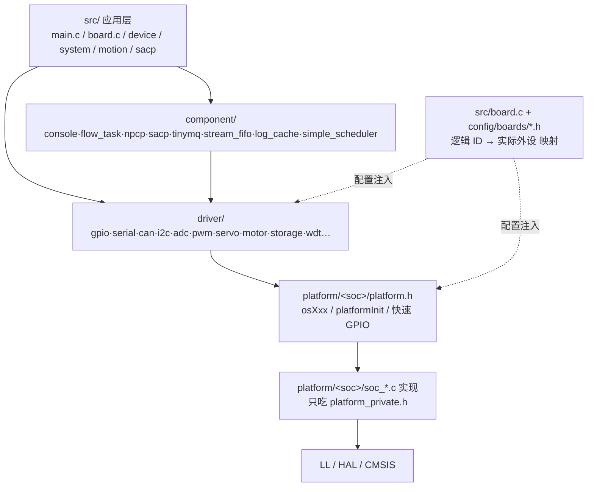

# 4x_mcu 工程开发流程与框架分析

> 版本：v1.0（2026-10-29）
> 分析对象：`~/001-workspace/003-MCU/4x_mcu/`（Neptune 机器人主控板 MCU 工程，**只读分析，未修改**）
> 对照基准：本工作区 `embedded-monorepo-ai-plan.md`（v1.2 顶层环境方案）
> 定位：**参考实现笔记**——记录该工程的架构与流程，提炼可借鉴项与差距项，不复制其代码

---

## 目录

- [0. 结论先行](#0-结论先行)
- [1. 工程全景（物理结构）](#1-工程全景物理结构)
- [2. 框架分层](#2-框架分层)
- [3. 端到端开发流程（9 步）](#3-端到端开发流程9-步)
- [4. 与顶层方案对照：一致与差距](#4-与顶层方案对照一致与差距)
- [5. 学习路线（4 周）](#5-学习路线4-周)
- [6. "开发建议"该怎么指定（给 AI 的可执行约束）](#6-开发建议该怎么指定给-ai-的可执行约束)
- [附录 A. 关键路径速查](#附录-a-关键路径速查)
- [附录 B. 论断的代码依据](#附录-b-论断的代码依据)

---

## 0. 结论先行

| # | 结论 | 依据 |
|---|---|---|
| 1 | **性质**：产品应用仓 + 平台框架子模块的单产品工程；构建系统是 **Keil MDK（`.uvprojx` + 编译目标）**，不是 CMake；交付依赖 **Python 脚本链**（版本号 → 后处理生成镜像 → 打包 → 串口升级） | `mdk/post_build.bat`、`set_version.py`、`package.py`、`tools/flashx.py` |
| 2 | **框架思想与本工作区方案高度一致**：逻辑 ID 抽象、平台适配隔离、板级配置单一来源、组件扁平化、配置逐层覆盖——是我们 §4「分层 + 配置外置 + 驱动不写死引脚」的工业落地版 | `framework/README.md` 设计目标、`docs/platform_header_architecture.md` |
| 3 | **差距集中在"约束与验证"层面**：无 host 单测、无 clang-format/tidy/`-Werror` 落地、无架构守护脚本、无 AI 约束文件（`AGENTS.md`/instructions/skills） | 仓库中无 `tests/`、无 `.clang-format`、无 `.github/`、无 CI 配置 |
| 4 | **最值得借鉴**：交付链（版本→镜像→包→MD5→升级）、每驱动自带 CLI、逻辑 ID 用枚举 | 见 §4.1 |
| 5 | **最不该照搬**：submodule 依赖管理、配置需手工四处同步、Keil 手工勾选源文件 | 见 §4.2 |
| 6 | **学习路径**：跑通 `demo_mcu` → 端到端追一条 GPIO/串口链路 → 加一个驱动 + 一条 SACP 属性 → 完整走一遍发版升级 | 见 §5 |

一句话概括：**这套框架的"开发流程"= 配置驱动 + 逻辑 ID + 每驱动 CLI + 版本/打包链，代码风格只是附赠品。**

---

## 1. 工程全景（物理结构）

| 目录 | 职责 | 归属层 |
|---|---|---|
| `src/` | 产品应用：`main.c` 启动序列、`board.c` 板级初始化、`device/` `system/` `motion/` `sacp/` `wait_queue/` 业务 | 产品层 |
| `src/config/` | `framework_config.h`（产品开关/数量）、`export_ids.h`（逻辑 ID 枚举）、`boards/neptune_one/board_mb_v*.h`（引脚下发）、`FreeRTOSConfig.h` | 产品/板级 |
| `framework/` | **独立 GitHub 仓**（`neptune-robotics/mcu_framework`）以 git submodule 引入：`source/platform`（4 套后端：`stm32` / `stm32-hal` / `gd32` / `linux`）+ `source/driver`（20 类驱动）+ `source/component`（25 个组件）+ `project/`（demo/bootloader） | 平台框架 |
| `third/` | 第三方算法、操作系统 | 三方 |
| `mdk/` | Keil 工程 `.uvprojx` + `post_build.bat`（镜像合成） | 构建 |
| `tools/` | `flashx.py` 串口升级 + `target_n1*.json`（设备/波特率） | 交付 |
| `released/` | 发版记录 + `released/bootloader/`（配套引导程序） | 交付 |
| `docs/` | 机制文档（见下表） | 文档 |
| `package.py` | 归档 + MD5 | 交付自动化 |
| `set_version.py` | 版本号三处同步 | 交付自动化 |
| `README.md` / `CHANGELOG.md` / `TODO.md` | 流程说明 / 变更记录 / 遗留问题 | 工程治理 |

### 1.1 `docs/` 的文档粒度（值得借鉴）

每篇文档只讲**一个机制**，而不是写一份"大设计文档"：

| 文件 | 讲什么 |
|---|---|
| `platform_header_architecture.md` | 配置头文件分层 + CMake 演进背景（含迁移待办清单） |
| `device.md` | 外设面板接口 ↔ 软件名称/索引/地址 ↔ PM 模块 的对应关系 + 产测信息修改命令 |
| `data_unit.md` / `controller_state.md` / `running_mode.md` | 数据单元 / 控制器状态机 / 运行模式 |
| `sacp_operation.md` | 协议操作手册 |
| `pinfo.md` / `mem_check.md` / `hardware_id.md` / `id_box_config.md` | 单项机制 |

判定：**一篇文档 = 一个可独立检索的机制**，避免"改一处忘一处"。

---

## 2. 框架分层

### 2.1 代码依赖方向（单向向下）



**关键约束**：应用层与组件层**只能看到 `driver/xxx.h` 与 `platform.h` 的 `osXxx` 接口**；`LL/HAL/CMSIS` 只在 `soc_*.c` 内出现。这是"换板少改代码"的唯一保险。

### 2.2 配置的五层覆盖链（由 `generic.h` 串联）

```text
src/config/framework_config.h                          产品要什么（开哪些驱动、几路串口、日志缓存…）
   └─ #include "boards/neptune_one/platform_stm32.h"    板级：选平台后端 + TRACE UART / DMA / PINFO 覆盖
        └─ #define CONFIG_PLATFORM_HEADER "stm32-hal/platform.h"
framework/source/platform/<x>/platform_config.h         平台默认值（#ifndef 包裹 → 板级先定义即覆盖）
framework/source/platform/<x>/platform_private.h        实现私有（LL/HAL、内部 API，仅 soc_*.c 使用）
```

- 所有模块统一入口：`#include <common/generic.h>`。
- 覆盖语义：**板级（或编译器 `-D`）先定义 → `platform_config.h` 的 `#ifndef` 不再生效**。同一宏在板级与默认配置中同时出现属于"覆盖模式"，不是冗余。
- 一句话备忘（来自 `platform_header_architecture.md` §6）：
  > `framework_config` = 产品要什么；板级头 = 这块板怎么接；`platform.h` = 上层怎么用；`platform_config` = 平台默认值；`platform_private` = 实现细节；`generic.h` = 把它们串起来。

### 2.3 逻辑 ID 抽象（最值得学习的一招）

`src/config/export_ids.h` 只定义**逻辑名**，板级头把逻辑名绑到实际端口/引脚，驱动层只认 `id`：

```text
export_ids.h:      enum EXPORT_GPIO { LED_SYS = 0, HARDWARE_ID0, ... , EXPORT_GPIO_MAX_NUM }
board_mb_v2_1.h:   逻辑 ID → GPIOx / Pin（板级唯一来源）
framework_config.h: #define CONFIG_GPIO_MAX_NUM EXPORT_GPIO_MAX_NUM      ← 数量自动跟随
driver/gpio:       gpioSet(LED_SYS, 1)                                    ← 只认逻辑 ID
```

优点：

1. **编译期安全**：拼错 ID 直接编译失败，不需运行期查错；
2. **容量自动同步**：加一个枚举项，`CONFIG_*_MAX_NUM` 自动跟随，避免"加资源忘改容量"；
3. **可枚举调试**：`board.c` 里保留 `export` 命令（当前被 `#if 0` 关闭）可打印全部逻辑 ID 名称与索引。

### 2.4 三个工程化好习惯

| 习惯 | 表现 | 价值 |
|---|---|---|
| **每驱动自带 CLI** | `driver/*/cli_*.c`（`cli_gpio` `cli_serial` `cli_can` `cli_adc` `cli_rtc` `cli_i2c` `cli_dev`…），`main.c` 统一注册 | 上板即可用命令行验证硬件，无需先写测试代码；等价于"最小可用自检手段" |
| **协议属性表化** | `src/sacp/sacp_*.c` 每模块一张属性表 + 读写回调；`sacpDumpAllAttributes()` 导出协议文档；`sacp_template.c` 作为新增模板 | 协议即数据，文档可自动生成，避免"代码与协议文档对不上" |
| **统一 Trace 形态** | 文件头固定 `#define TRACE_ENABLE / TRACE_TAG / TRACE_LEVEL` 后 `#include <common/trace.h>` | 日志按模块开关与分级，编译期可裁剪 |

### 2.5 平台后端的现状

`framework/source/platform/` 下并存 4 套后端，每套都是同构的 `platform.h` / `platform_config.h` / `platform_private.h` + `soc_*.c` 集合：

| 后端 | 说明 |
|---|---|
| `stm32-hal` | 基于 ST 官方 HAL，支持 STM32F4xx / STM32G03x |
| `stm32` | 早期寄存器/精简单实现 |
| `gd32` | 国产替代平台 |
| `linux` | 主机侧验证（可编译/可跑） |

**混用风险**：本工程用 `stm32-hal`，但 `mdk/*.uvprojx` 通过**手工勾选**决定编译哪套 `soc_*.c`——头文件只能决定"包含哪个 `platform.h`"，**不能**决定编哪些源文件（`platform_header_architecture.md` §5.1 已明确指出）。

---

## 3. 端到端开发流程（9 步）

| 步 | 动作 | 产物 / 位置 |
|---|---|---|
| 0 | 环境：Keil MDK + `git submodule update --init` | `framework/` 就位 |
| 1 | **选板 + 选编译目标**：目标名 `<Type>_<MachineName>`（如 `n1_hw21_app_debug`），通过 `BOARD_NEPTUNE_ONE_MB_*` 宏指定硬件 | `mdk/*.uvprojx` 的 target |
| 2 | **写配置三处**：产品开关/数量 → `framework_config.h`；引脚与外设实例 → `boards/neptune_one/board_mb_v*.h`；新资源 → `export_ids.h` 加逻辑 ID | `src/config/` |
| 3 | **加驱动/组件**：接口头（`xxxInit` / `xxxSend`…）+ 平台无关 `xxx.c` + 平台实现 `soc_xxx.c` + `cli_xxx.c` | `framework/source/{driver,component}` |
| 4 | **应用集成**：`main.c` 启动序列（board 初始化 → driver init → `sacpServerInit` → 任务创建）、`board.c` 板级初始化、`src/sacp/*` 属性表注册 | `src/` |
| 5 | **构建**：Keil 编译 → `post_build.bat` 调 `mcuimage` 合成 **`ota.img` / `ota_encrypt.img` / `factory.bin`**，并复制 `.axf` / `.map` | `mdk/Objects/`、`mdk/Listings/` |
| 6 | **改版本**：`./set_version.py 4.4.2` 同步 `src/version.h` + `*.uvprojx`（post_build 参数）+ `CHANGELOG.md` | 三处自动一致 |
| 7 | **打包**：`python package.py` → `released/controller_n1_v<ver>/`（根目录放 `bin/img`，`debug/` 放 `map/axf`）+ `zip` + `md5` | `released/` |
| 8 | **升级上板**：`./flashx.py -t target_n1.json xxx_ota.img`（460800，XMODEM）；先 `naiad_stop.sh` 停服务释放串口 | `tools/` |
| 9 | **留痕**：`CHANGELOG.md`（按 `[vX.Y.Z] 机型` 分组写"新增/修复/影响面"）、`TODO.md`、`released/` | 交付审计 |

### 3.1 流程特征与隐患

| 特征 | 说明 |
|---|---|
| 全链脚本化但**半自动** | 第 6、7 步靠人执行脚本，未接入 CI；漏执行 → 出现"版本号写了但镜像还是旧的" |
| 版本号**三处同源** | `version.h` + `uvprojx` 内嵌 post_build 参数 + `CHANGELOG.md`，靠脚本保证，无校验 |
| 配置**四处同步** | `export_ids.h`（逻辑 ID）/ 板级头（映射）/ `framework_config.h`（数量）/ `uvprojx`（编译目标宏）——漏一处编译"成功"但行为错 |
| 构建选择靠人 | 源文件集合由 Keil 工程勾选决定，新增 `soc_*.c` / 驱动 `.c` 忘勾选 → 链接报错或行为缺失 |
| 无自动化验证 | 无 host 单测、无一致性测试、无静态检查门禁；唯一验证手段是上板 + CLI 命令 |

---

## 4. 与顶层方案对照：一致与差距

### 4.1 一致且值得借鉴

| 我们的原则（plan） | 4x_mcu 的落地证据 | 借鉴结论 |
|---|---|---|
| 分层依赖单向、业务不碰芯片头 | 应用/组件只 include `driver/*.h`、`platform.h`；LL/HAL 只在 `soc_*.c` | ✅ 与 §4.1 同构；可作为 `check_layers.py` 的正样本目录约定 |
| 配置外置、板级单一来源 | `boards/neptune_one/board_mb_v*.h` 是引脚唯一来源；`board.c` 只做 `#if defined(BOARD_*)` 分发 | ✅ 比"驱动里写 GPIOA"严格得多 |
| 板级差异集中、不在业务撒 `#ifdef` | `#ifdef BOARD_XXX` 仅出现在 `board.c` 与板级头 | ✅ 与"差异只允许在 `port/`"同义 |
| 分层配置 + 覆盖模式 | `platform_config.h` 用 `#ifndef` 给默认值，板级先定义即覆盖 | ✅ 可直接抄进 `board.yaml → board_config.h` 的设计 |
| OSAL 抽象 | `platform.h` 提供 `osXxx`（Malloc / Reboot / 时间等） | ✅ 对应 §5.1 osal 原语 |
| 组件扁平、无意义层级不做 | `component/` 25 个平铺小组件 | ✅ 与"组件扁平化"一致，可作命名样板 |
| 版本 + CHANGELOG + 脚本收敛 | `version.h` + `set_version.py` + `package.py` | ✅ 正是 `release-check` skill 该做的事 |
| 文档按"机制"拆分 | `docs/` 每篇一个机制 | ✅ 比"一个大设计文档"更可维护，值得照抄粒度 |

**额外值得抄的两点（本方案原先缺失）**：

1. **每驱动一个 CLI**——比 host 单测更早上手的低成本验证手段，可与 `ctest` 互补。
2. **逻辑 ID 用枚举而非字符串/生成宏**——编译期即校验，且容量宏自动跟随。

### 4.2 不一致 / 需要改进

| 维度 | 我们的方案 | 4x_mcu 现状 | 判断 |
|---|---|---|---|
| 构建 | CMake + Presets + Ninja，板卡切换靠 preset | Keil `.uvprojx` + 编译目标 + 手工勾选源文件 | ❌ 不抄；其 `platform_header_architecture.md` §5 已列出 CMake 迁移待办，**可直接当迁移 review 清单** |
| 依赖管理 | 单份共享 `libs/`，明确否定 submodule | `framework` 是 submodule | ❌ 不抄（版本漂移；AI 易在子模块内误提交） |
| 单测 | host `ctest` + Unity/CMock + 一致性测试 | 无 `tests/` 目录，仅 CLI 手测 + 真机 | ❌ 必须补，这是 AI 自闭环验证的前提 |
| 静态检查 | `-Wall -Wextra -Werror -Wconversion` + clang-format/tidy | 只有 `framework/docs/coding/coding_rules_c.md` 文字规范 | ❌ 必须转成可执行配置 |
| 架构守护 | `tools/check_layers.py` | 无，靠约定俗成 | ❌ 必须补 |
| AI 约束 | `AGENTS.md` + instructions + skills + hooks | 无（AI 只能读 README/docs） | ❌ 这是我们要补的空白 |
| 配置一致性 | `project.yaml` 单一事实来源 | 需手工同步**四处** | ❌ 典型隐患，需脚本校验 |
| 动态内存 | 禁 malloc | 有 `osMalloc` + `mem_trace` 组件，未见硬性禁令 | 🟡 取其 `mem_trace` 思路（用量统计）作兜底 |

### 4.3 该工程"有而我们没有"的能力（补进方案）

| 能力 | 说明 | 建议落点 |
|---|---|---|
| **Bootloader + 双镜像** | `released/bootloader/*.bin` 与 `mcuimage -o 512 -b 0x10000 -A app.bin` 合成 ota/factory 镜像（含加密镜像） | `docs/standards/release-guide.md` + `release-check` skill |
| **镜像头与版本绑定** | `mcuimage -V %VERSION%` 把版本写进镜像头，Bootloader 可校验 | 同上 |
| **串口 XMODEM 升级工具** | `flashx.py` + 板卡 json（设备/波特率） | 可直接借鉴为 `tools/flash/` |
| **协议文档自生成** | `sacpDumpAllAttributes()` | 我们的"协议即数据"可对应实现 |
| **内存跟踪** | `component/mem_trace` | 作为"禁 malloc"的兜底观测手段 |
| **多机型编译目标命名规范** | `<Type>_<MachineName>` + `BOARD_XXX` 宏 | 对应我们 `CMakePresets.json` 的 preset 命名规范 |

---

## 5. 学习路线（4 周）

| 阶段 | 做什么 | 验收（可自检） |
|---|---|---|
| W1 | 读 `framework/README.md` 设计目标 → 跑 `framework/project/demo_mcu`（裸机）与 `demo_mcu_freertos`；用 `pin` / `gpio` 命令点灯 | 能在命令行列出并翻转所有 GPIO |
| W2 | **端到端追一条链路**：`export_ids.h` 的 `LED_SYS` → `board_mb_v2_1.h` 映射 → `driver/gpio` → `soc_gpio.c` → 硬件；同时读 `docs/platform_header_architecture.md` | 能画出链路，并说出"换一块板要改哪 3 个文件"（答案：板级头 + `uvprojx` target + 少量 `framework_config.h`） |
| W3 | **模仿加功能**：仿 `driver/wdt` 或 `driver/tamper` 加一个小驱动（含 `cli_xxx.c`）+ 一条 SACP 属性（仿 `src/sacp/sacp_template.c`） | 能用 `sacp read` / `sacp write` 读到新属性 |
| W4 | **走一次完整交付**：改 `version.h` → `set_version.py` → 编译 → `post_build.bat` → `package.py` → `flashx.py` 升级 | `released/` 下包内容与 `CHANGELOG.md` 一致，MD5 可校验 |

---

## 6. "开发建议"该怎么指定（给 AI 的可执行约束）

分四层给，**每层都要可验证**，否则 AI 会礼貌地忽略。

### 第 1 层：`AGENTS.md`（≤120 行，常驻）——草案

```markdown
# 4x_mcu 工程约定

## 开始任务前
1. 读 src/config/framework_config.h（产品开关/数量）与 boards/neptune_one/board_mb_*.h（引脚）
2. 读 src/board.c 确认当前 BOARD_XXX 分支
3. 涉及协议改动，先读 docs/sacp_operation.md 与 src/sacp/sacp_template.c

## 硬性禁止
- 禁止在 src/、component/ 中出现 stm32f4xx_hal.h / LL 头 / CMSIS 寄存器操作
  验证：grep -rn "stm32f4xx\|__IO\|GPIOA" src/ framework/source/component | grep -v cli_
- 禁止在驱动/应用层写死引脚或端口号；引脚只能来自 board_mb_*.h + export_ids.h
  验证：grep -rn "GPIO[ABCDE], *GPIO_PIN" framework/source/driver src | grep -v soc_
- 新增 GPIO / 串口 / CAN 资源，必须先在 export_ids.h 加逻辑 ID，再在板级头映射
- 禁止在 ISR 中 printf / 阻塞 / osDelay
- 禁止手工改 mdk/Objects/*、released/**（生成物）
- 版本号只允许经 ./set_version.py 修改（禁止手改 version.h 或 uvprojx）

## 分层与命名
- 新驱动 = driver/<name>/<name>.h + <name>.c + cli_<name>.c，平台实现放 platform/<soc>/soc_<name>.c
- 驱动对外 API 前缀统一（gpioSet / gpioGet），返回值语义写进头注释
- 文件头注释：@brief / @param / @return，注明 ISR/线程上下文与可重入性
- 缩进 4 空格、大括号独占行、静态全局 s_、全局 g_（见 framework/docs/coding/coding_rules_c.md）

## 完成标准
- Keil 编译 0 warning（新增代码不得引入 warning）
- 新硬件可验证路径：提供 CLI 命令或 SACP 属性，能上板一条命令验证
- 涉及发版：CHANGELOG.md 已按 [vX.Y.Z] 机型 分组补记
```

### 第 2 层：把"文字规范"变成"可执行断言"

| 约定 | 落地手段 |
|---|---|
| 分层不越界 | `tools/check_layers.py`：扫描 `src/` 与 `framework/source/component` 是否出现 HAL/LL 头（按其现有目录约定，10 行正则即可） |
| 引脚不写死 | 同脚本加一条：`driver/` 与 `src/` 中出现 `GPIO_PIN_` 即报错 |
| 配置四处一致 | `tools/check_config.py`：比对 `export_ids.h` 枚举项数与 `framework_config.h` 的 `CONFIG_*_MAX_NUM == EXPORT_*_MAX_NUM` |
| 版本一致 | `set_version.py --check`：`version.h` / `uvprojx` / `CHANGELOG.md` 三处版本号必须相同（前两个正则已有，扩一下即可） |
| 编码风格 | `.clang-format` 按 `coding_rules_c.md` 生成一次，之后**以文件为准**，文档只作解释 |

### 第 3 层：给 golden example，不给口令

在 `docs/templates/module/` 放一个**满分模块**（照 `driver/tamper` 裁剪）：

```text
xxx.h             契约注释（@param / @return / 上下文 / 可重入）
xxx.c             平台无关实现，只依赖 generic.h + platform.h
cli_xxx.c         CLI 命令（自检手段）
soc_xxx.c         平台实现（仅此处出现 LL/HAL）
sacp_xxx.c        SACP 属性表骨架（协议接入）
uvprojx 勾选清单   新增源文件需在哪些 target 中加入
```

规则里只写一句：**「新模块结构照 `docs/templates/module/`，不接受其他结构」**。

> 模仿的稳定性远高于服从文字——这一条对 AI 的有效性高于其他所有条目之和。

### 第 4 层：三个 skill（触发词写清楚）

| Skill | 触发场景 | 为什么值得单独写 |
|---|---|---|
| `add-driver` | "加一个传感器/外设驱动" | 强制 `export_ids → 板级头 → driver → soc → cli` 五步不漏 |
| `add-sacp-attr` | "新增一条协议属性" | 属性表 + 读写回调 + dump 文档三件套容易漏 |
| `release` | "发版/打包/升级" | 版本三处同改 + `post_build` + `package.py` + 升级验证，顺序错就出"版本写了但镜像还旧"的事故 |

---

## 7. 建议的落地动作（在 `900-test` 内）

1. **定位**：把 `4x_mcu` 当**参考实现**（读结构、读配置链、读交付脚本），不复制其代码；`projects/` 仍按顶层方案分层。
2. **抄三样**：逻辑 ID 用枚举 + 数量自动跟随；每驱动一个 CLI；`platform_config.h` 的 `#ifndef` 覆盖模式。
3. **补三样**：CMake preset 切板（替代 uvprojx 手工勾选）；`check_layers.py` + `check_config.py`；`AGENTS.md` + 上述三个 skill。
4. **文档可复用**：`platform_header_architecture.md` §5（CMake 迁移必改项 / 不建议做的事）几乎可原样变成 `docs/adr/0005-cmake-migration.md`。

---

## 附录 A. 关键路径速查

```text
# 配置链
src/config/framework_config.h
src/config/export_ids.h
src/config/boards/neptune_one/platform_stm32.h
src/config/boards/neptune_one/board_mb_v1_1.h / _v2_0.h / _v2_1.h / _v4_0.h
src/board.c                                       板级初始化 + BOARD_XXX 分发
src/board.h

# 框架入口
framework/source/platform/common/generic.h         统一入口
framework/source/platform/stm32-hal/platform.h     平台对外 API
framework/source/platform/stm32-hal/platform_config.h
framework/source/platform/stm32-hal/platform_private.h
framework/source/platform/stm32-hal/soc_*.c        平台实现（含 stm32f4xx/ stm32g03xx/ 子目录）

# 驱动 / 组件
framework/source/driver/<name>/<name>.h  <name>.c  cli_<name>.c
framework/source/component/<name>/
src/sacp/sacp_template.c                           新增 SACP 属性的模板

# 构建 / 交付
mdk/neptune_one_stm32f446.uvprojx
mdk/neptune_one_stm32f446_ll.uvprojx
mdk/post_build.bat
src/version.h
set_version.py
package.py
tools/flashx.py
tools/target_n1.json
released/bootloader/

# 规范 / 文档
framework/docs/coding/coding_rules_c.md
framework/docs/trace_usage.md
docs/platform_header_architecture.md
```

## 附录 B. 论断的代码依据

| 论断 | 依据文件 |
|---|---|
| 逻辑 ID 抽象、数量自动跟随 | `src/config/export_ids.h`；`src/config/framework_config.h` 中 `CONFIG_GPIO_MAX_NUM EXPORT_GPIO_MAX_NUM` 等 |
| 板级分发集中在 `board.c` | `src/board.c` 的 `#if defined(BOARD_NEPTUNE_ONE_MB_V4_0) ... #else #error` |
| 驱动只认逻辑 ID、平台无关 | `framework/source/driver/serial/serial.h`（`serialInit(configs)` / `serialSend(id,...)`，`SERIAL_TRACE`） |
| 配置五层覆盖与 `generic.h` 串联 | `docs/platform_header_architecture.md` §2 / §3 / §6 |
| CMake 迁移痛点与待办 | `docs/platform_header_architecture.md` §5.4 / §5.5 / 第 7 节待办清单 |
| 每驱动自带 CLI | `src/main.c` 中 `#include <gpio/cli_gpio.h>`、`<serial/cli_serial.h>`、`<can/cli_can.h>` 等注册 |
| SACP 属性表 + 自生成文档 | `src/sacp/sacp_system.c`（属性表、`localAttributeWriteApply`）、`framework/CHANGELOG.md` 中 `sacpDumpAllAttributes()` |
| 镜像合成与版本注入 | `mdk/post_build.bat`（`mcuimage -V %VERSION% -o 512 -H -B boot.bin -b 0x10000 -A app.bin`） |
| 打包与 MD5 | `package.py`（`_target_files` 中 `ota.img` / `ota_encrypt.img` / `factory.bin` / `map` / `axf`；`generate_md5`） |
| 版本三处同步 | `set_version.py`（`update_version_h` / `update_uvprojx_files` / `update_changelog`） |
| 串口升级 | `tools/README.md` + `tools/flashx.py` + `tools/target_n1.json`（`/dev/ttyTHS2`, 460800） |
| 多机型编译目标命名 | `README.md` 中 `<Type>_<MachineName>`、`n1_hw21_app_debug` 等表格 |
| 编码规范仍为纯文字 | `framework/docs/coding/coding_rules_c.md`（缩进/大括号/命名/`s_`/`g_` 前缀），仓库内无 `.clang-format` / `.clang-tidy` / CI |
| 子模块依赖 | `.gitmodules`（`framework` → `git@github.com:neptune-robotics/mcu_framework.git`） |
