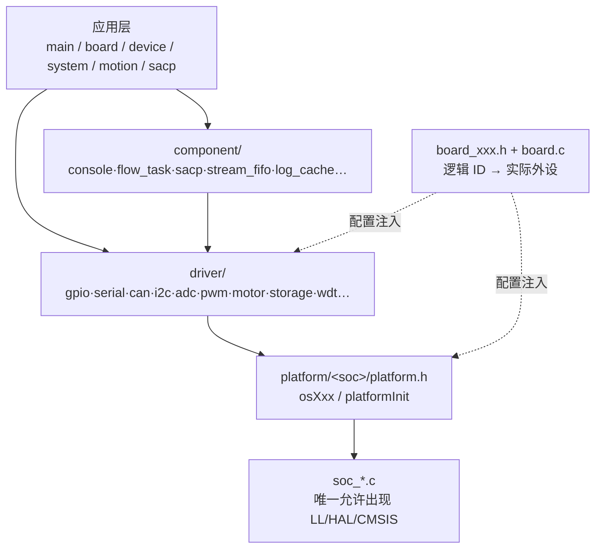
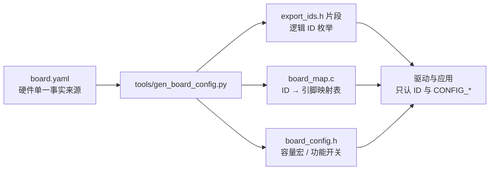

# ADR-0001 板级配置的表达方式：分层头文件 + 逻辑 ID，还是 DTS

- **状态**：Proposed
- **日期**：2026-10-30
- **决策范围**：平台层（所有工程适用）
- **相关**：`docs/guides/module-development.md`、`docs/reference/4x-mcu-framework-analysis.md`

---

## 0. 结论

| # | 结论 |
|---|---|
| 1 | **不引入 DTS**。当前规模（1~2 块板、单团队、CMake 自建）下，dtc + binding 的成本远高于收益。 |
| 2 | **采用折中方案**：`board.yaml` 作为硬件单一事实来源，构建期生成 C 头/映射表，取代“手工同步四处”。 |
| 3 | **逻辑 ID 抽象保留**，它是编译期类型安全与“换板零改动”的关键，DTS 的 `label/alias` 只是它的另一种写法。 |
| 4 | **配置链分层保留但简化**：起步只做 3 层（产品 / 板级 / 平台默认），出现第二个平台后再补平台选择层与私有层。 |
| 5 | 若将来板数 ≥4 或需接入 Zephyr/Linux 生态，yaml schema 按“节点/属性”设计，可平滑迁移到 DTS。 |

---

## 1. 背景：N1 框架的分层架构

参考实现（下称 N1）是一套“产品应用 + 平台框架”的单产品工程，构建用 Keil MDK，交付依赖 Python 脚本链。

### 1.1 依赖方向（单向向下）



**核心约束**：应用与组件层只能看到 `driver/xxx.h` 与 `platform.h` 的 `osXxx`；`LL/HAL/CMSIS` 只出现在 `soc_*.c`。

### 1.2 五个可借鉴要素

| 要素 | 做法 | 价值 |
|---|---|---|
| 逻辑 ID 抽象 | `export_ids.h` 只写逻辑名；板级头绑定引脚；驱动只认 `id` | 编译期校验、容量宏自动跟随 |
| 配置覆盖链 | 产品 → 板级 → 平台选择 → 平台默认（`#ifndef`）→ 私有 | 板级差异不外泄 |
| 每驱动自带 CLI | `cli_gpio` / `cli_i2c`… 统一注册 | 上板即可验证硬件，不依赖业务代码 |
| 协议属性表化 | 每模块一张属性表 + 读写回调，可自动导出文档 | 协议即数据，代码与文档不脱节 |
| 交付链 | 版本 → 镜像合成 → 打包 → MD5 → 串口升级 | 可审计、可复现 |

### 1.3 已知隐患（本方案必须规避）

| 隐患 | 后果 |
|---|---|
| 配置**四处手工同步**（ID / 映射 / 容量 / 编译目标） | 漏一处仍能编译，但行为错 |
| 源文件靠 IDE 手工勾选 | 新增 `.c` 忘加 → 链接期报错或功能缺失 |
| `framework` 用 submodule 引入 | 版本漂移；AI 易在子模块内误提交 |
| 无 host 单测、无静态检查 | 唯一验证手段是上板 + CLI |

---

## 2. 两个关键概念

### 2.1 配置链

一串按顺序 include 的头文件，靠 `#define` + `#ifndef` 实现“越早定义越优先”。

```c
/* 平台默认值：只有上层没定义时才生效 */
#ifndef CONFIG_UART_BAUDRATE
#define CONFIG_UART_BAUDRATE 115200
#endif
```

| 层 | 回答的问题 | 允许出现的宏 | 禁止 |
|---|---|---|---|
| L1 产品 | 这个产品**要什么** | 功能开关、容量、业务参数 | 具体引脚、寄存器 |
| L2 板级 | 这块板**怎么接** | 引脚、端口、外设实例、后端选择 | 业务语义 |
| L3 平台选择 | 用**哪套平台** | 仅 `CONFIG_PLATFORM_HEADER` | — |
| L4 平台默认 | 平台**兜底值** | 全部 `#ifndef` 包裹 | 依赖上层已定义值 |
| L5 平台私有 | 实现**怎么做** | 内部宏、寄存器地址 | 被上层 include |

**设计要点**

| 要点 | 规则 | 违反的后果 |
|---|---|---|
| 外置粒度 | 只外置“换产品/换板会变”的 | 配置项爆炸 |
| 默认值形态 | 一律 `#ifndef` | 板级定义被静默覆盖 |
| 命名 | `CONFIG_<模块>_<属性>` | grep 不可靠 |
| 容量宏 | 由枚举哨兵派生，不手写 | 加资源忘改容量 → 越界 |
| 唯一来源 | 同一语义只在一层定义 | 改一处忘一处 |
| 时机 | 全部编译期常量 | 配置变状态，无法穷举测试 |

### 2.2 逻辑 ID 抽象

用**功能名**代替**物理位置**，中间加一张映射表。

```c
/* 1) 平台/产品侧：只有逻辑名 */
typedef enum {
    LED_SYS = 0,
    LED_ERR,
    BTN_RESET,
    EXPORT_GPIO_MAX_NUM      /* 哨兵：容量自动跟随 */
} export_gpio_t;

/* 2) 板级侧：唯一绑定物理引脚的地方 */
static const gpio_map_t s_gpio_map[EXPORT_GPIO_MAX_NUM] = {
    [LED_SYS]   = { PORT_A, 5,  ACTIVE_HIGH },
    [LED_ERR]   = { PORT_B, 12, ACTIVE_LOW  },
    [BTN_RESET] = { PORT_C, 3,  ACTIVE_LOW  },
};

/* 3) 驱动/应用侧：只认 ID */
gpio_set(LED_SYS, 1);
```

| 收益 | 说明 |
|---|---|
| 编译期检查 | 拼错 ID 直接编译失败 |
| 容量自动同步 | `CONFIG_GPIO_MAX_NUM = EXPORT_GPIO_MAX_NUM` |
| 换板零改动 | 只改板级映射，业务不变 |
| 可枚举调试 | CLI 列出全部 ID 与当前值 |
| 协议一致 | 上位机/产测用同一套 ID |

**设计要点**

| 要点 | 规则 |
|---|---|
| 粒度 | 每类资源一个枚举（GPIO / SERIAL / I2C / ADC / PWM…） |
| 命名 | 功能语义（`LED_SYS`），不用位置（`GPIOA_5`） |
| 编号 | 从 0 连续，末尾必须 `MAX_NUM` 哨兵 |
| 稳定性 | 已发布的 ID 只增不改不重排；删除时保留 `RETIRED_x` |
| 归属 | 定义在平台/产品侧，映射在板级 |
| 校验 | `static_assert(ARRAY_SIZE(map) == MAX_NUM)` |

### 2.3 三者的边界（最容易混）

| 内容 | 归属 | 例子 |
|---|---|---|
| “有几路串口” | 配置链（容量宏） | `CONFIG_SERIAL_MAX_NUM` |
| “调试串口是哪一路” | 逻辑 ID | `UART_DEBUG = 1` |
| “波特率多少” | 配置链（板级覆盖） | `CONFIG_UART_DEBUG_BAUD 115200` |
| “有没有这个资源” | ID 枚举是否存在 | 枚举里没有即不存在 |
| “引脚是 PA5” | 板级映射 | `{ PORT_A, 5 }` |

**口诀：数量 → 配置；身份 → ID；位置 → 板级。**

---

## 3. 与 DTS 的区别

### 3.1 概念对照

| 本方案概念 | DTS 对应物 | Kconfig 对应物 |
|---|---|---|
| `export_ids.h` 枚举 | node label / `aliases` | — |
| 板级映射表 | 节点属性（`reg`、`gpios`、`pinctrl-0`） | — |
| `CONFIG_X_MAX_NUM` | — | `int` / `range` |
| 功能开关 | 节点 `status = "disabled"` 或节点不存在 | `bool` / `tristate` |
| 平台默认值 `#ifndef` | SoC `.dtsi` 默认属性 | `default` |
| 板级覆盖 | overlay | `board_defconfig` |
| `CONFIG_PLATFORM_HEADER` | `compatible` 匹配 | — |

> **关键洞察**：N1 的“配置链”其实混了两种信息——**硬件事实**（引脚接哪）与**产品选择**（要不要这个功能）。DTS 管前者，Kconfig 管后者，二者正交。

### 3.2 本质差异

| 维度 | DTS | 分层头文件 + 枚举 |
|---|---|---|
| 载体 | 声明式数据（树 + 节点 + `phandle`） | C 宏 + `enum` + 手写映射表 |
| 事实来源 | 单一 `.dts`（+ `.dtsi`） | 3~4 处（ID / 映射 / 容量 / 开关） |
| 生成 | `dtc` → `devicetree_generated.h` | 无生成，全手写 |
| 覆盖 | overlay 叠加 | `#ifndef` 先定义优先 |
| 结构能力 | 树形，可表达“设备挂在哪个控制器下” | 平铺，跨类关系靠代码约定 |
| 校验 | `dtc` + binding schema（类型/必填/范围） | `static_assert` + 自写脚本 |
| 类型安全 | 弱（宏展开，拼错在链接/运行期暴露） | 强（枚举拼错编译失败） |
| 调试 | `dtc -I dtb -O dts` 反编译 | 直接读头文件 |
| 上手成本 | 高（dtc / binding / overlay / compatible） | 低 |
| 生态 | 与 Zephyr / Linux 互通 | 自成一套 |

### 3.3 各自缺什么

| DTS 有而本方案缺 | 本方案有而 DTS 弱 |
|---|---|
| 单一事实来源 | 零工具链、零生成步骤 |
| 结构化 schema 校验 | 编译期强类型 |
| 层级与引用（控制器 ↔ 设备） | 调试直观（改完直接编） |
| `.dtsi` 复用 / overlay 叠加 | AI 友好（纯 C，无需学 dts 与 binding） |

### 3.4 何时该上 DTS

| 条件 | 决策 |
|---|---|
| 1~2 块板、单团队、CMake 自建 | ❌ 不上，用 `board.yaml` 生成 |
| ≥4 块板或 ≥2 个 SoC，板级差异失控 | 🟡 考虑；yaml schema 按节点/属性设计，便于迁移 |
| 目标接入 Zephyr / Linux、复用上游驱动 | ✅ 直接上 DTS |

---

## 4. 决策：折中方案

### 4.1 架构



### 4.2 yaml 形态（示例）

```yaml
# projects/<id>/board/board.yaml        示例：路径中的 <id> 为占位
soc: stm32f407
resources:
  gpio:
    - { id: LED_SYS,    port: A, pin: 5,  active: high }
    - { id: LED_ERR,    port: B, pin: 12, active: low  }
  serial:
    - { id: UART_DEBUG, instance: 1, baud: 115200, tx: [A, 9], rx: [A, 10] }
features:
  enable_log: true
  log_level: 3
```

### 4.3 生成物与规则

| 产物 | 内容 | 是否入库 |
|---|---|---|
| `generated/export_ids.h` | 各类资源枚举 + 哨兵 | ✅ 入库（便于 diff 与 review） |
| `generated/board_map.c` | `const` 映射表 | ✅ 入库 |
| `generated/board_config.h` | 容量宏、功能开关 | ✅ 入库 |
| 生成器 | `tools/gen_board_config.py` | ✅ 入库 |

**红线**

- 生成目录 `generated/` 标记为**禁改**（与 `AGENTS.md` §4 一致）。
- 生成器必须幂等：重复运行输出一致，CI 校验 `git diff --exit-code`。
- 生成前校验：ID 重复、映射空洞、容量与哨兵不一致 → 失败退出。

### 4.4 与 DTS 的可迁移性

| 设计约束 | 目的 |
|---|---|
| yaml 用 `resources:` 下的**节点列表**而非扁平键 | 形态接近 DTS 节点 |
| 每个资源带 `id`（≈ label）与属性字典（≈ properties） | 迁移时一一对应 |
| 预留 `compatible` 字段 | 未来可直接映射为 DTS 节点 |

---

## 5. 后果

### 5.1 正面

- 硬件信息**一处维护**，消除 N1“四处同步”的隐患。
- 生成物可 diff、可 review，错误在生成期暴露而非上板期。
- 保持零工具链依赖，AI 可直接读写 yaml 与 C。
- 保留逻辑 ID 的编译期强类型。

### 5.2 负面 / 代价

| 代价 | 缓解 |
|---|---|
| 多一步生成（改 yaml 后需重跑） | 接入 CMake 自定义命令，构建时自动生成 |
| 生成器本身是代码，需要维护与测试 | 保持 <150 行、纯 stdlib、带自检 |
| 表达力弱于 DTS（无层级、无 phandle） | 现阶段用不到；需要时再迁移 |
| 生成物入库会带来 diff 噪声 | 依赖生成器幂等 + 格式化稳定 |

### 5.3 不采用本决策的后果

- 继续手工维护四处：第一块板不会出问题，第三块板开始出现“编译通过但引脚接错”，排查成本远高于写生成器。
- 直接上 DTS：可能在 dtc 语法与 binding 上耗掉两周，却仍未写出第一个驱动。

---

## 6. 落地顺序

| 步 | 动作 | 验收 |
|---|---|---|
| 1 | 定义 yaml schema（gpio / serial 两类起步） | schema 文档 + 样例 |
| 2 | 写 `tools/gen_board_config.py` | 生成三类文件，幂等 |
| 3 | 接入 CMake 自定义命令 | 改 yaml → 构建自动更新 |
| 4 | 第一个驱动（GPIO）改用生成物 | `check_layers.py` 通过、CLI 可验证 |
| 5 | 加校验（重复 ID、映射空洞） | 造一个错误用例，生成器必须失败 |

**M2 里程碑**（第二个平台）是唯一有效验证：若换平台时 `app/` 有 diff，说明抽象边界错了，回到第 1 步修。
