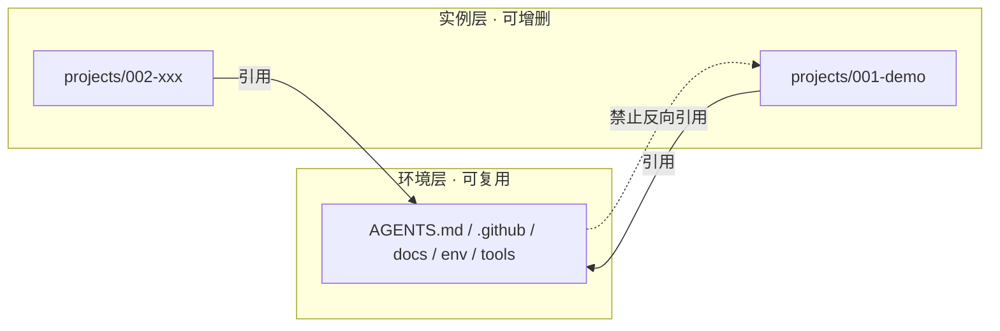
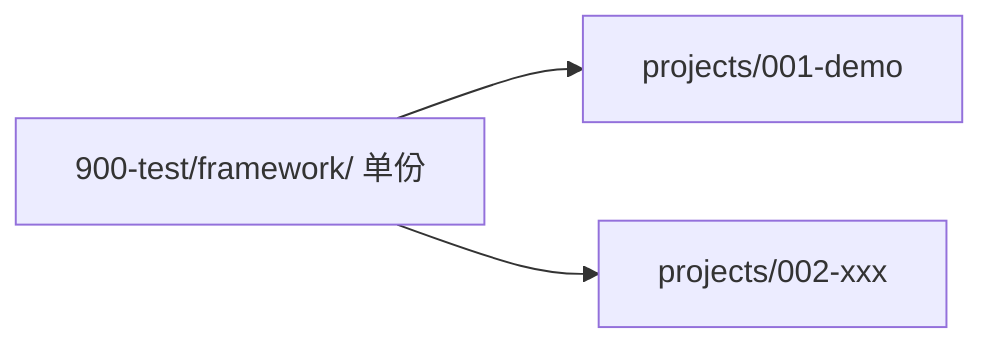
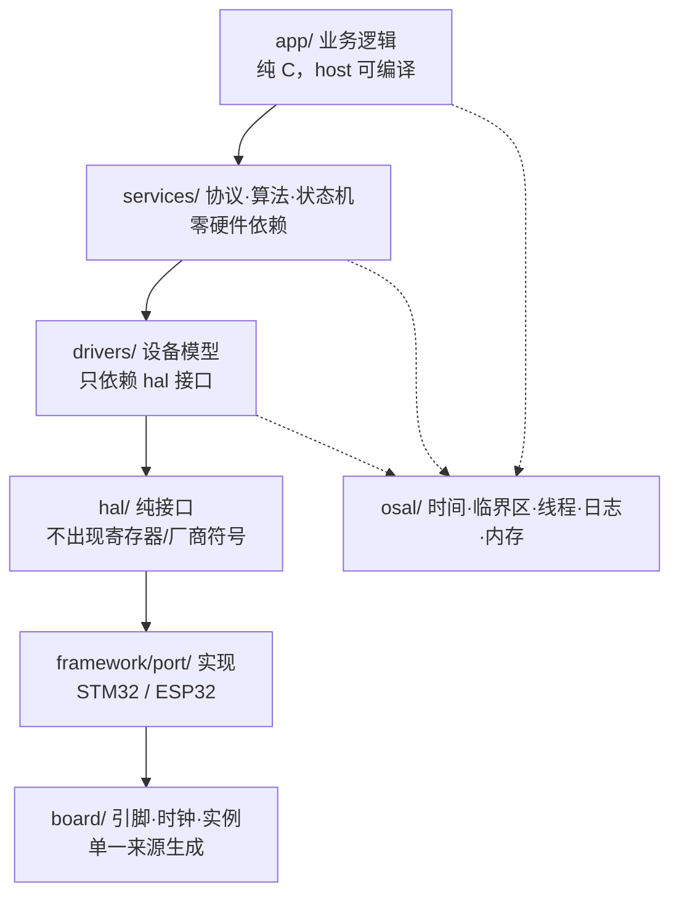
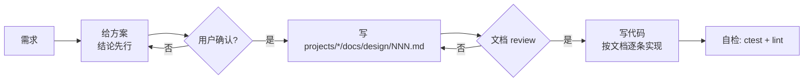
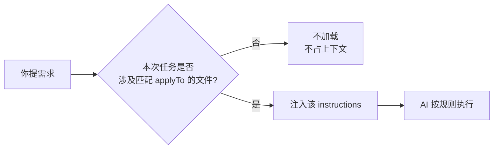

# 嵌入式 C 多工程 AI 协作开发环境 —— 设计方案

> 版本：v1.4（2026-11-02）
> 修订：v1.4 统一为"**framework 单份共享**" —— 共享框架统一为顶层 `framework/`（含 `port/<soc>/`）；工程内不出现 `framework/` 或 `port/` 副本；§1.7 中残留的 `libs/` 为旧命名
> **定位：顶层环境方案**——作用于 `900-test/` 整个工作区（平台层），**不属于任何单个工程**；`projects/` 下的示例仅用于说明，不构成对某个工程的规定。
> 适用：`/home/clara/001-workspace/900-test` 作为空白起点，嵌入式 C 为主，含少量 Python/Shell 工具，多工程可独立可交互。
> 目标：仓库可整包下载即用、与内部有哪些工程完全解耦；全 AI 参与开发下，文档充足、约束可执行、跨智能体可快速接手。

---

## 目录

- [0. 结论先行](#0-结论先行)
- [1. 环境设计：目录 + 约束体系](#1-环境设计目录--约束体系)
- [2. 可套用的开源项目 / 框架](#2-可套用的开源项目--框架)
- [3. 嵌入式 C：必须遵守 vs 建议](#3-嵌入式-c必须遵守-vs-建议)
- [4. 最大复用 + 面向对象 C + Linux 内核框架](#4-最大复用--面向对象-c--linux-内核框架)
- [5. 移植分层：STM32 → ESP32](#5-移植分层stm32--esp32)
- [6. 规范/文档从哪来、是否约束 AI、你需不需要](#6-规范文档从哪来是否约束-ai你需不需要)
- [7. 落地路线图 + 反模式代价](#7-落地路线图--反模式代价)
- [附录 A. 协作协议（人机约定）](#附录-a-协作协议人机约定)
- [附录 B. 五类自定义文件速查](#附录-b-五类自定义文件速查)
- [附录 C. instructions 详解](#附录-c-instructions-详解)
- [附录 D. prompts 详解](#附录-d-prompts-详解)
- [附录 E. agents 详解（角色）](#附录-e-agents-详解角色)

---

## 0. 结论先行

| # | 决策 | 为什么 |
|---|---|---|
| 1 | **单一工作区 = 环境层（可复用骨架）+ 工程实例层（`projects/`，可增删）**，两层单向依赖；`framework/`（含 `port/<soc>/`）**共享单份**，工程内不复制 | 环境与工程混在一起会让“下载即用”失效；每工程各存一份框架则各自分叉、改一处崩一片 |
| 2 | 约束分四层：**全局 `AGENTS.md`（常驻）→ 路径级 `*.instructions.md`（glob 匹配）→ skill（按需）→ hook（确定性强制）** | 常驻上下文有注意力预算，全塞进 `AGENTS.md` 会被稀释；纯文字约束不可验证 |
| 3 | **每条约束必须可被命令验证**（grep / clang-tidy / 单测 / 架构脚本），否则不写 | 不可验证的规则对人和 AI 都只是摆设 |
| 4 | 默认规范选 **Barr-C:2018 + `-Werror -Wconversion`**；MISRA 仅在认证需求时启用子集 | MISRA 全套对 AI 成本极高且需商业检查器，个人项目收益/成本比差 |
| 5 | 移植能力来自 **“HAL 只表达能力、不表达寄存器” + OSAL 原语抽象 + 板级配置单一来源** | 换板改动量取决于抽象边界画在哪，与代码写得多漂亮无关 |
| 6 | 构建用 **CMake + CMakePresets + Ninja**，抄 Zephyr/PlatformIO 的**分层与板级配置思想**，而非整套框架 | 直接上 Zephyr 会锁死构建与驱动模型；但其 `board/`、`soc/`、dts 思路值得借鉴 |

---

## 1. 环境设计：目录 + 约束体系

### 1.1 目录结构

目录分为两层：**环境层**（可复用、可下载、与工程无关）与**实例层**（具体工程，可随时增删）。

```text
900-test/                              # 工作区根
├── AGENTS.md                          # ★ 全局约束（常驻，≤120 行）
├── README.md                          # 环境入口：装什么、怎么加工程
├── bootstrap.sh                       # ★ 新电脑一键就绪：检查工具链、生成目录
├── .githooks/commit-msg               # 提交信息校验（见 §1.8）
├── .github/
│   ├── instructions/
│   │   ├── c-embedded.instructions.md      # applyTo: "**/*.{c,h}"
│   │   ├── build-system.instructions.md    # applyTo: "**/CMakeLists.txt,**/*.cmake"
│   │   └── python-tools.instructions.md    # applyTo: "tools/**/*.py"
│   ├── skills/
│   │   ├── design-first/SKILL.md
│   │   ├── new-project/SKILL.md
│   │   ├── port-board/SKILL.md
│   │   ├── add-driver/SKILL.md
│   │   └── release-check/SKILL.md
│   ├── prompts/
│   │   ├── review-module.prompt.md
│   │   └── write-unit-test.prompt.md
│   ├── agents/
│   │   └── bringup.agent.md        # 上板调试：只读 + 跑命令
│   └── hooks/
│       └── protect-generated.json  # 禁止改生成代码/链接脚本
├── docs/                           # ★ 只放平台资产，禁止出现具体工程内容
│   ├── adr/                        # 平台级架构决策 0001-xxx.md
│   ├── standards/
│   │   ├── coding-style.md
│   │   └── porting-guide.md
│   ├── guides/                     # 使用手册：加工程 / 接新电脑 / 升级环境
│   └── templates/
│       ├── CMakeLists.txt          # 模板冒烟构建（唯一构建入口）
│       ├── framework_demo/         # 框架骨架 → 展开为环境层 framework/
│       └── project_demo/           # 工程骨架 → 复制为 projects/<id>/
├── env/                            # ★ 环境层构建资产（与工程无关）
│   ├── cmake/                      # 公共 CMake 模块（Project.cmake 等）
│   ├── presets/base.json           # 预设模板，工程继承后只写差异
│   └── toolchains/                 # arm-none-eabi.cmake / esp32.cmake
├── tools/
│   ├── check_layers.py             # 架构守护：禁止业务层引用芯片头
│   ├── gen_board_config.py         # board.yaml -> board_config.h
│   └── run_host_tests.sh
├── framework/                      # ★ 共享单份：common/ osal/ drivers/ components/ port/<soc>/（见 §1.7）
└── projects/                       # ★ 实例层，可整体 .gitignore
    ├── <id>/                       # 由 docs/templates/project_demo/ 复制
    │   ├── AGENTS.md               # ★ 工程级约束（只写差异）
    │   ├── README.md  build.sh     # 工程说明 / 构建入口
    │   ├── project.yaml            # ★ 机器可读元信息（id / soc / toolchain / presets / 共享框架位置）
    │   ├── docs/design/            # ★ 方案文档（approved 后才允许编码）
    │   ├── src/
    │   │   ├── main.c              # 启动序列：boardInit → sacpInit → 任务
    │   │   ├── config/             # export_ids.h（逻辑 ID）/ framework_config.h（容量、开关）
    │   │   ├── system/board.c      # 描述符表：引脚 / 地址 / 参数唯一来源
    │   │   ├── sacp/               # 协议属性接入（号段 / 上报组 / 写回调）
    │   │   └── ld/                 # 链接脚本（占位）
    │   ├── test/                   # host 单测（+ 目标板一致性测试）
    │   └── tools/  data/           # 工程级脚本 / 现场数据（占位）
    └── <id2>/
```

> 工程内**不出现 `framework/`、`port/` 副本**；驱动与平台后端一律改共享框架。
> 业务代码变多时可再加 `src/app/`、`src/services/` 子目录，分层见 §4.1。

**两条硬规则**

1. **单向依赖**：工程层可以引用环境层（用 `env/` 的 preset、模板、工具）；**环境层不得引用任何工程**。
2. **共享单份**：`framework/`（含 `port/<soc>/`）只有一份，所有工程引用同一版本；**工程内不得出现 `framework/` 或 `port/` 副本**。只服务一个工程的代码放该工程 `src/<mod>/`，不进 `framework/`。

**不这么做会怎样**

- 环境层引用具体工程名 → 换电脑 clone 时带上一堆无关工程；工程删除后根文档全是死链。
- 把只服务一个工程的代码塞进平台 `framework/` → 环境层被具体需求污染，换电脑 clone 到无关代码，删工程后 `framework/` 成垃圾场。
- 把工具链/引脚写死在工程内而不进 preset → 换板、换电脑都要重配一遍。

### 1.2 约束的四层分工

| 层 | 位置 | 加载时机 | 放什么 | 不要放什么 |
|---|---|---|---|---|
| **常驻约束** | `AGENTS.md`（根 / 每工程） | 始终在上下文 | 硬性红线、构建与验证命令、文档索引、冲突处理规则 | 教程、长篇说明、示例代码 |
| **按路径约束** | `.github/instructions/*.instructions.md` + `applyTo` | 相关文件进入上下文时 | C 语言细则、CMake 约定、Python 工具约定 | 与路径无关的流程 |
| **按需流程** | `.github/skills/<name>/SKILL.md` | AI 按 `description` 匹配任务时 | “建新工程”“移植到新板”“发版检查”等多步骤流程，可带脚本模板 | 长期红线 |
| **确定性强制** | `.github/hooks/*.json` | 工具调用前后 | 拦截改写生成文件、保存后自动格式化、提交前跑 lint | 需要判断力的规则 |
| **角色隔离** | `.github/agents/*.agent.md` | 显式调用 | 只读探索、只能改 `test/`、只能跑命令 | 通用规范 |

**判断口诀**

- 适用于“大部分工作”→ instructions
- 只适用于“特定任务”→ skill
- “不允许发生”→ hook（文字约束是概率性的，hook 是确定性的）
- “单次带参数任务”→ prompt（`/review-module`）

### 1.3 AGENTS.md 怎么写

**五条原则**

1. 写给“没有记忆的新同事”，但不教基础语法。
2. 每条约束 = **规则 + 理由 + 验证方式**，缺一条就会被忽略。
3. 总长度 ≤ 120 行；超出部分挪到 `docs/standards/*.md`，只留链接。
4. 写“禁止/必须”，不写“尽量/建议”。
5. 显式声明优先级：工程级覆盖全局，但安全红线不可被覆盖。

**根 `AGENTS.md` 骨架**

```markdown
# 平台约定（所有工程适用）

## 这个仓库是什么
- 分两层：**环境层**（`AGENTS.md`、`.github/`、`docs/`、`env/`、`tools/`）= 可复用骨架；
  **实例层**（`projects/<id>/`）= 具体工程，可随时增删。
- 依赖方向单向：工程可引用环境层，**环境层禁止引用任何具体工程**。
- 每个工程有独立 `AGENTS.md` 与 `project.yaml`；冲突时以更深的 AGENTS.md 为准，
  但「硬性禁止」一节不可被覆盖。

## 开始任何任务前
1. 读 `projects/<id>/project.yaml`（板卡、芯片、工具链、构建 preset）。
2. 读该工程 `AGENTS.md`。
3. 只 include 公共接口，不 include 芯片厂商头文件——见 `tools/check_layers.py`。

## 硬性禁止
- 禁止在 `projects/<id>/src/**`、`framework/**` 出现 `stm32*hal.h` / `esp_*.h` / `freertos.h`。
  验证：`python tools/check_layers.py`
- 禁止修改 `framework/third_party/**`、`**/generated/**`、`**/*.ld`、`**/startup_*.s`。
- 禁止直接修改 `.deps/**`（由同步脚本重建）；`.deps/` 必须在工程 `.gitignore` 中。
- 禁止 `malloc/free`（用 `osal_mem_pool_*`）；禁止 ISR 中阻塞、打印、动态分配。
- 禁止 `#ifdef STM32 / ESP32` 出现在 `projects/<id>/src` 与 `framework`（差异只允许在 `framework/port/<soc>/`）。
- 禁止在环境层（`AGENTS.md`、`docs/`、`env/`、`.github/`、`tools/`）写具体工程名或芯片型号。
  例外：`docs/design/`（平台方案）与 `docs/reference/`（外部工程分析）允许示例性质的名称。
  验证：`grep -rn "projects/00" docs/standards docs/guides docs/adr AGENTS.md env/ tools/ .github/ | grep -v 示例`

## 语言与类型
- 固定宽度整数（`stdint.h`），禁止裸 `int/long` 做存储或协议字段。
- 编译选项：`-Wall -Wextra -Werror -Wconversion -Wshadow -Wundef`，警告未清零视为未完成。
- 所有等待/循环必须有超时或终止条件。

## 完成标准（Definition of Done）
- `cmake --preset host && ctest --preset host` 全绿
- `cmake --preset <board> && cmake --build --preset <board>` 无警告
- `clang-format --dry-run --Werror` 通过
- 新增模块必须同时有：头文件契约注释、host 单测；>10 文件时补模块级 AGENTS.md

## 提交规范（每次 commit 必填）
- 标题格式：`<type>(<scope>): <一句话做了什么> [<task> §<章节>]`
- 正文必须三行：`Task:` 任务号 ｜ `Design:` 方案文档路径 + `§` 章节 ｜ `Part:` 本次实现的是该章节的第几部分
- 一个 commit 只对应方案文档的**一个章节**；跨章节必须拆分
- 禁止：`update`、`fix bug`、`修改`、`优化一下` 这类无信息标题
- 验证：`.githooks/commit-msg`

## 文档索引
- 编码细则：`docs/standards/coding-style.md`
- 移植方法：`docs/standards/porting-guide.md`
- 使用手册（加工程/接新电脑）：`docs/guides/`
- 平台架构决策：`docs/adr/`
- 工程内文档：`projects/<id>/docs/`（方案 `design/`、决策 `adr/`）
```

**工程级 `AGENTS.md`（只写差异）**

```markdown
# 001-demo 工程约定

继承根 `AGENTS.md`。本文件只写差异与特有时序。

## 硬件
- MCU: STM32F407 / 168MHz；APP 起始 0x08004000（bootloader 占 16K）
- 外设实例与引脚唯一来源：`src/system/board.c`（禁止在 .c 里写 GPIOA / Pin_5；若后续改用 `board/board.yaml` 生成，则以其产物为准）

## 特有红线
- TIM2 已被占用，禁止复用。
- `src/app/control_loop.c` 必须 1kHz 内完成，新增代码须附最坏执行时间估算。

## 验证
- `cmake --preset stm32f407 && cmake --build --preset stm32f407`
- HIL：`tools/hil/run_001.py`（需板子，CI 跳过）
```

**反例（会真实伤害你）**

- 把 MISRA 全文贴进 `AGENTS.md` → 上下文被占满，关键规则被稀释。
- 只写“请写高质量代码” → 无法执行、无法验收。
- 根与工程级内容大段重复 → 改一处忘一处，另一处变成“说谎的文档”。

### 1.4 skill 怎么建

一个 skill = 一个可重复的多步流程 + 模板/脚本；`description` 是唯一发现入口，触发词必须写进去。

```text
.github/skills/port-board/
├── SKILL.md
├── checklist.md
└── templates/port_dir/
```

```markdown
---
name: port-board
description: "Use when: 把现有工程移植到新板卡/新芯片（如 STM32 -> ESP32），
  新增 framework/port/<soc> 实现、board.yaml、CMake preset，并运行 HAL 一致性测试。"
---

# 移植到新板

## 步骤
1. 读 `docs/standards/porting-guide.md` 与目标工程 `AGENTS.md`。
2. 列出现有 `framework/port/<old>/` 的**能力清单**（不是函数清单）。
3. 复制 `templates/port_dir` 到 `framework/port/<new>/`，逐个实现 hal/osal。
4. 生成 `board/board_<new>.yaml`，跑 `python tools/gen_board_config.py`。
5. 加 CMake preset：`cmake --preset <new>`。
6. 跑一致性测试：`ctest -R conformance`。
7. 输出报告：0 改动 / 新增 / 必须改动，三栏表。

## 禁止
- 不允许在 `src/app` 加 `#ifdef`。
- 不允许复制 `framework/port/<old>` 后逐个函数改名——接口一致就该零改动编译。
```

**建议先建的 4 个 skill（按投入产出排序）**

| Skill | 触发场景 | 价值 |
|---|---|---|
| `design-first` | 收到任何开发/改造/移植需求 | 强制“方案 → 确认 → 归档 → 编码”，避免返工 |
| `new-project` | “新建一个工程” | 消除脚手架不一致 |
| `port-board` | “换板子/移植” | 把第 5 节方法固化为流程 |
| `add-driver` | “加传感器/外设驱动” | 强制走 hal ops + 单测 + mock 固定形态 |
| `release-check` | “发版/交付前检查” | lint/size/版本号收成一条命令 |

**不要建的**：编码风格 skill（属于常驻/路径约束）、“写代码”skill（太泛，永不匹配）。

### 1.5 环境层与工程层的解耦规则

**目标**：仓库可整包下载即用，与“里面有什么工程”完全无关。



**内容归属判定**

| 内容 | 放哪 | 判据 |
|---|---|---|
| 通用编码规范、模板、脚手架、工具链 preset | 环境层 | 与具体芯片/工程无关 |
| 平台级技术决策（为何 monorepo、为何 CMake） | `docs/adr/` | 影响所有工程 |
| 方案文档、工程级 ADR、板级配置、`board.yaml` | `projects/<id>/` | 提到具体引脚/型号/时序 |
| 只在单个工程使用的代码 | `projects/<id>/src/<mod>/` | 应用模块，不是共享库 |
| 所有工程共用的驱动/组件/平台后端 | 平台 `framework/`（含 `port/<soc>/`） | 共享单份，工程内不得复制 |

**工程间引用必须显式**（禁止靠目录相邻隐式引用）。**默认阶段不写 deps**：所有工程共用 `framework/` 同一版本；只有需要“不同工程不同版本”时才启用版本坐标，详见 [§1.7](#17-framework原-libs依赖管理策略含决策过程)。

```yaml
# projects/003-gateway/project.yaml —— 仅在启用版本锁定时使用
deps:
  - fw://crc16@v1.2.0           # 平台共享库，tag
  - fw://lwip@feat/dma          # 开发期：分支
  - project://002-comm          # 引用另一个工程，可追溯
```

**三种落地方式**

| 方式 | 做法 | 适用 |
|---|---|---|
| **A. 单仓 + 忽略工程**（推荐） | 一个 git 仓库；`.gitignore` 忽略 `projects/*`；环境与工程同机不同步 | 个人、工程不外传 |
| **B. 模板仓 + 独立工程仓** | 环境仓库设为 GitHub Template；每个工程独立仓，clone 后 `bootstrap.sh` 就绪 | 工程需独立交付/版本 |
| **C. 环境作 submodule** | 工程仓把环境仓作为 submodule | 团队需锁定环境版本 |

**换电脑的 4 步**（方式 A/B 通用）

```bash
git clone <env-repo> && cd 900-test
./bootstrap.sh              # 检查/安装工具链、生成 projects/ 与 .gitignore
# 新建工程：让 AI 走 new-project skill
# 恢复已有工程：把工程目录拷回 projects/ 即可
```

**自检命令**（可进 CI）：

```bash
grep -rn "projects/00" docs/ AGENTS.md env/ tools/ | grep -v 示例   # 环境层不得引用工程
git check-ignore projects/001-demo && echo "工程未入库，符合预期"
```

### 1.6 `docs/` 目录说明

**只放平台资产**，共 4 个子目录。真正的“说明书”只有 `standards/` 与 `guides/`；`adr/` 是决策记录，`templates/` 是样板。

#### 1.6.1 `docs/adr/` —— 平台级架构决策

| 文件 | 作用 | 谁读 / 何时 |
|---|---|---|
| `0000-template.md` | ADR 格式模板（背景 / 决策 / 备选 / 后果） | 写新决策时 |
| `0001-two-layer-layout.md` | 为何“环境层 + 工程层”两层单仓 | 新 AI 接手、想推翻结构前 |
| `0002-build-cmake-presets.md` | 为何 CMake + Presets，而非 Zephyr/PlatformIO | 同上 |
| `0003-hal-ops-model.md` | 为何 HAL 用 ops 函数表而非直接封装 SDK | 改接口设计前 |
| `0004-no-dynamic-memory.md` | 为何禁 malloc、用静态池 | 有人想加 malloc 时 |

- 只记录**不可逆或代价高**的选择；单条 ≤1 页。
- 过期不删，标 `Superseded by 00xx`。
- **为什么需要**：AI 最爱“顺手重构”；有 ADR，改结构前会先读理由。

#### 1.6.2 `docs/standards/` —— 规范细则（`AGENTS.md` 的详情页）

| 文件 | 作用 | AI 何时读 |
|---|---|---|
| `coding-style.md` | 命名、缩进、文件/函数长度、注释契约的完整版 | 被 `c-embedded.instructions.md` 引用时 |
| `error-handling.md` | 错误码枚举、超时策略、返回值检查规则 | 同上 |
| `testing.md` | host 单测组织、mock 规则、覆盖率要求 | 写测试时（skill 引用） |
| `porting-guide.md` | 移植能力清单、OSAL 八原语、验收标准 | `port-board` skill 必读 |
| `review-checklist.md` | 评审清单（分层 / 并发 / 超时 / 所有权） | `/review-module` 或评审角色 |

⚠️ 这些文件**不会自动生效**，必须被 `AGENTS.md` 或 skill 显式引用。

#### 1.6.3 `docs/guides/` —— 操作手册（给人看的）

| 文件 | 作用 |
|---|---|
| `getting-started.md` | 新电脑：clone → `bootstrap.sh` → 验证工具链 → 跑通 hello |
| `add-project.md` | 新增工程 5 步 + 常见错误 |
| `upgrade-env.md` | 环境层升级时如何迁到已有工程 |
| `faq.md` | “配了不生效”“工程间如何引用”等高频问题 |

单列理由：这类内容是**流程**不是规范。塞进 `AGENTS.md` 占常驻预算，塞进 `standards/` 又找不到。

#### 1.6.4 `docs/templates/` —— 样板（AI 照抄的对象）

| 路径 | 作用 | 消耗者 |
|---|---|---|
| `framework_demo/` | **框架骨架**：`common/`、`osal/`、`drivers/`、`components/`、`port/host/`；展开为环境层 `framework/` | `add-module` skill |
| `project_demo/` | 新工程脚手架：`AGENTS.md`、`project.yaml`、`src/{config,system,sacp}`、`test/`（**不含 `framework/`、`port/`**） | `new-project` skill |
| `CMakeLists.txt` | 两个模板的冒烟构建（`smoke_app` / `smoke_test`），唯一构建入口 | CI / 本地验证 |

这两个目录是全环境性价比最高的地方：给 AI 一个"可模仿的正确答案"，胜过 100 条文字规范。

#### 1.6.5 工程内 `docs/`（对照，不属于平台层）

| 路径 | 放什么 |
|---|---|
| `projects/<id>/docs/design/` | 本工程方案文档（`status: approved` 才能编码） |
| `projects/<id>/docs/adr/` | 本工程的技术选型（如“为何用 SPI 而非 I2C”） |

判定标准不变：**提到具体引脚 / 型号 / 工程名 → 归工程；否则归平台。**

#### 1.6.6 最小起手（只建 3 个）

| 优先级 | 文件 | 理由 |
|---|---|---|
| 1 | `docs/standards/coding-style.md` | 承接 `AGENTS.md` 放不下的细则 |
| 2 | `docs/templates/framework_demo/` | 决定 AI 的代码“品味” |
| 3 | `docs/guides/add-project.md` | 让“加工程”不依赖人的记忆 |

`adr/`、`porting-guide.md`、`review-checklist.md` 等有真实痛点后再补——空文档会腐烂，过期文档会误导 AI 严格执行错误内容。

### 1.7 framework（原 libs）依赖管理策略（含决策过程）

> 本节保留历史命名：下文出现的 `libs/`、`libs::`、`libs://`、`.deps/libs` 均指共享框架 `framework/`。

#### 1.7.0 结论

| 阶段 | 策略 |
|---|---|
| **默认（现在）** | 平台 `libs/` **单份共享**，所有工程同一版本；工程直接引用，不写版本号 |
| 出现“并行多版本”需求 | 库仓独立 + 每工程 `git worktree` 指向不同分支 / tag |
| 交付 / 长期锁定 | tag + `deps.lock`（记录 commit sha） |
| **明确不用** | submodule（除非库要对外发布且多人维护） |

**一句话**：默认共享一份，最省事；只有“不同工程必须同时用不同版本”才升级到 worktree。

#### 1.7.1 决策过程（为什么否定其他方案）

| 方案 | 结论 | 原因 |
|---|---|---|
| 每工程复制一份 `libs/` | ❌ | 各自分叉，bug 修复无法同步，三个月后三份实现 |
| `git submodule` | ❌ 起步不用 | 流程重；切换分支后版本漂移；AI 易在子模块内误提交 |
| 每工程独立 clone **同一分支** | ⚠️ 慎用 | 会产生分叉，push 互相覆盖，需要“唯一写者”约定 |
| 一个 worktree 给多个工程共用 | ❌ 不可行 | git 不允许同一分支被两个 worktree 检出 → 天然趋同于“共享一份” |
| **平台单份共享 `libs/`** | ✅ 默认 | 改一次全部生效，零同步成本 |
| **worktree + 分支** | ✅ 升级路径 | 每工程独立工作树，可各自提交推送，互不干扰 |

**关键认知**：一个目录只有一个工作树，因此“所有工程共用同一版本”与“共享一份目录”是同一件事；一旦要并行不同版本，必须让**物理目录分开**。

#### 1.7.2 默认方案：单份共享



- 工程通过 **CMake imported target**（`fw::crc16`）引用，禁止相对路径 `#include "../../framework/..."`。
- 改 framework 直接改，所有工程立即生效。
- **唯一代价**：改 framework 后必须构建**全部**工程——工程数量少时完全可接受。
- 规则：改动 framework 的人负责跑一遍所有依赖工程的构建（起步阶段可行）。

#### 1.7.3 升级路径：什么时候上 worktree

满足**任意一条**才升级：

1. 工程 A 要改 libs 接口，而工程 B 当前版本不能被影响；
2. 特性开发周期 > 2 周，需要长期独立分支；
3. 需要同时验证同一库的两个版本。

结构：

```text
~/libs-src/                      # 库仓唯一克隆（裸用或普通仓）
900-test/
├── libs/                        # 开发主副本（主分支）
└── projects/001-demo/
    └── .deps/libs/              # worktree 指向 feat/xxx 或 v1.2.0（gitignore）
```

```bash
git -C ~/libs-src worktree add \
    /path/900-test/projects/001-demo/.deps/libs -b feat/dma
```

| worktree 优点 | 说明 |
|---|---|
| 无二次克隆 | 共用同一 `.git`，磁盘/网络开销≈0 |
| 无 detached HEAD 混乱 | 比 submodule 少一个数量级的坑 |
| 可在工程内直接 commit / push | 分支属于仓库，不属于 worktree |
| 对 AI 友好 | 就是普通目录，无需理解子模块语义 |

#### 1.7.4 三种依赖坐标

| 坐标 | 写法 | 用途 | 需要 push 吗 |
|---|---|---|---|
| 本地路径 | `path://../../.deps/libs` | 日常开发、联调 | ❌ |
| 分支 | `libs://crc16@feat/dma` | 跨机协作、他人复用 | ✅ |
| tag / commit sha | `libs://crc16@v1.3.0` / `@a1b2c3d` | 交付、回归、长期锁定 | ✅ |

**开发期用路径或分支，交付期才用 tag**——tag 不是验证的前提。

#### 1.7.5 tag 的时机

| 做法 | 评价 |
|---|---|
| 先打 tag 再验证 | ❌ 版本号被测试性提交污染，失败只能打 `v1.3.1` |
| 验证通过后打 tag | ✅ 唯一正确顺序 |
| 打了 tag 又删除 | ❌ 他人已 fetch，造成“同 tag 不同内容” |
| 需要预发布标记 | ✅ 用 `v1.3.0-rc.1`，且不进公共 tag 空间 |

#### 1.7.6 多工程共用同一分支的规则

| 做法 | 适用 | 风险 |
|---|---|---|
| **共享一份目录**（推荐） | 所有工程本来就该同版本 | 无（代价是改动影响面大） |
| 多副本各自 checkout 同一分支 | 需要各自提交/跨机 | 分叉、忘记 pull、AI 在不同副本提交不同内容 |

**唯一写者原则**：同一分支只允许一个“提交入口”。其它副本只 `git pull`；必须临时修改时，切独立分支（`feat/001-xxx`），验证后合并回主干。

#### 1.7.7 红线与坑

| 红线 | 原因 |
|---|---|
| `.deps/` 必须进工程 `.gitignore`，`deps.lock` 入库 | 仓库干净 + 可复现（tag 可被移动，必须记 sha） |
| 禁止直接改 `.deps/**` 里的代码 | 同步脚本会重建目录，改动丢失 |
| worktree 用 `git worktree remove`，不要 `rm -rf` | 否则主仓留下失效 worktree 记录 |
| `.deps/libs` 内的 commit 只能进 libs 仓 | 防止把库改动混进工程提交 |
| 工程构建只认一个来源（`libs/` 或 `.deps/`） | 两套来源混用 → 找到哪个用哪个，问题只在别人机器上复现 |

### 1.8 提交信息规范

#### 1.8.0 结论

**每条 commit 必须回答三个问题：属于哪个任务的哪一节、交付了什么、怎么验证的。** 格式固定，可用 hook 校验。

```text
<type>(<scope>): <一句话做了什么> [<task> §<章节>]

Task: 004-uart-dma
Design: projects/001-demo/docs/design/004-uart-dma.md §4.2 中断接收路径
Part: 4.2 第 2/3 部分 —— 环形缓冲写入与溢出计数
Why: 原轮询方式在 115200 下丢帧约 0.3%
Verify: ctest -R uart_dma 通过；上板 10 分钟无丢帧
```

#### 1.8.1 字段定义

| 字段 | 必填 | 说明 |
|---|---|---|
| `type` | ✅ | `feat` / `fix` / `refactor` / `perf` / `test` / `docs` / `build` / `ci` / `chore` / `revert` |
| `scope` | ✅ | 模块名（`uart`、`hal_gpio`、`build`），**不是**工程名 |
| 标题描述 | ✅ | 动词开头，写“做了什么”，≤ 50 字符 |
| `[task §章节]` | ✅ | 任务号 + 方案文档章节，可一眼定位 |
| `Task:` | ✅ | 任务号，与 `docs/design/<task>.md` 同名 |
| `Design:` | ✅ | 方案文档路径 + 章节标题（路径必须真实存在） |
| `Part:` | ✅ | 本 commit 实现该章节的**第几部分**；整节一次完成则写 `全部` |
| `Why:` | ✅ | 为什么改（问题/动机），不是复述代码 |
| `Verify:` | ✅ | 验证命令与结果；未验证必须写明原因 |

#### 1.8.2 追溯三要素（本规范的核心）

| 要素 | 作用 |
|---|---|
| **Task** | 从 commit 追到任务 |
| **Design §** | 从 commit 追到方案的那一节，避免“代码和设计脱节” |
| **Part** | 从 commit 追到“这一节做到哪一步”，避免一个巨型 commit 说不清进度 |

三者齐全时，任何人（或 AI）都能回答：**这个改动是为了哪份设计文档的哪一段、做到什么程度了。**

#### 1.8.3 好坏对照

| ✅ 可用 | ❌ 禁止 |
|---|---|
| `fix(uart): 修正 DMA 超时未生效 [004 §4.2]` | `update` |
| `feat(hal_gpio): 新增 gpio ops 表 [003 §2.1]` | `fix bug` |
| `refactor(cfg): 拆分 board 配置生成 [007 §3]` | `修改了一些东西` |
| `test(crc): 补 crc16 边界用例 [005 §6.2]` | `优化一下` |

#### 1.8.4 AI 生成提交流程

1. 读 `project.yaml` 的任务号与当前分支对应的 `docs/design/<task>.md`；
2. 定位本次改动属于哪一节（对不上就**停下来问**，不要猜）；
3. 确认该方案的 `status: approved`，否则拒绝提交；
4. 按模板生成标题 + 正文，`Verify:` 必须来自**实际执行过的命令**；
5. 提交前自检：一个 commit 是否只覆盖一个章节。

#### 1.8.5 可执行校验

```bash
git config core.hooksPath .githooks      # 启用仓库内 hook
```

```bash
#!/usr/bin/env bash
# .githooks/commit-msg
msg="$1"; subject=$(head -n1 "$msg")

echo "$subject" | grep -Eq \
 '^(feat|fix|refactor|perf|test|docs|build|ci|chore|revert)\([a-z0-9_/-]+\): .+ \[[A-Za-z0-9._-]+ §[0-9]+(\.[0-9]+)*\]$' \
  || { echo "✗ 标题格式: <type>(<scope>): <描述> [<task> §<章节>]"; exit 1; }

for k in Task Design Part Why Verify; do
  grep -q "^$k:" "$msg" || { echo "✗ 缺少 $k: 行"; exit 1; }
done

design=$(sed -n 's/^Design: *//p' "$msg" | head -n1 | sed 's/ *§.*//')
[ -f "$design" ] || { echo "✗ 方案文档不存在: $design"; exit 1; }
grep -q '^status: approved' "$design" || { echo "✗ 方案未 approved，禁止提交"; exit 1; }
```

#### 1.8.6 粒度规则

| 规则 | 说明 |
|---|---|
| 一个 commit ↔ 方案文档的一个 § | 跨 § 必须拆分 |
| 一节太大时用 `§4.2.1` 或 `Part: 2/3` | 保证每条都能说清“做到哪” |
| 重构与功能分开提交 | 混合后无法单独回滚 |
| 格式化与改名单独一次 commit | 否则 diff 全被噪声淹没 |
| 单 commit 文件数 ≤ 10 | 超过通常说明没拆 |

#### 1.8.7 禁止项

- ❌ 混合无关改动（“顺手改”）；
- ❌ 提交构建产物、二进制、`.deps/`；
- ❌ 用 `--no-verify` 绕过 hook（除非在 PR 描述中说明原因）；
- ❌ 在方案文档 `status: draft` 时提交业务代码；
- ❌ `Verify:` 写“应该没问题”这类未执行的结论。

---

## 2. 可套用的开源项目 / 框架

| 项目 | 能抄什么 | 是否建议直接采用 |
|---|---|---|
| **Zephyr**（`west` + devicetree + `boards/` + `drivers/` + `subsys/`） | ★★★ 最值得抄**分层与板级配置思想**：dts 描述硬件、driver 用 `DT_*` 取配置、`soc/` 与 `board/` 分离 | ❌ 不建议整体套用（曲线陡、构建系统自成一派、压缩 AI 自由度）；当“参考实现库”读 |
| **PlatformIO** | 多环境 `env:`、统一工具链、`platformio.ini` 切板 | 🟡 适合快速多板对比；大型工程用 CMake |
| **CMSIS / CMSIS-Driver** | ★★ 标准化外设接口（`ARM_DRIVER_GPIO`）+ 版本化模式（`GetVersion/Initialize/Uninitialize/PowerControl/Control`） | ✅ 参考其接口形态，不必直接用 |
| **ESP-IDF**（`components/` + Kconfig） | 组件显式依赖声明 | ✅ 仅 ESP 工程用 |
| **STM32CubeMX + CMake** | 引脚/时钟配置生成为 `board_config` | ✅ 只用生成能力，生成目录标记禁改 |
| **libopencm3** | 轻量寄存器级抽象 | 🟡 可选 |
| **FreeRTOS** | OSAL 的后端实现 | ✅ STM32/ESP32 都支持，最好的跨板中立层 |
| **Ceedling / Unity / CMock / FFF** | ★★★ host-native 单测 + 自动 mock | ✅ 必装，“AI 能自验证”的分水岭 |
| **clang-format / clang-tidy / cppcheck / pre-commit** | 可执行的风格与静态检查 | ✅ 必装，约束可执行化的载体 |
| **Google `repo` / `west manifest`** | 多仓管理 | ❌ monorepo 不需要 |
| **`lizard` / `pmccabe`** | 圈复杂度、函数长度 | ✅ 轻量，卡住“AI 写 500 行函数” |

**推荐组合（务实路线）**

`CMake + CMakePresets + Ninja`（构建）+ `FreeRTOS`（OS 中立）+ 自研 ~200 行 CMSIS 风格 `hal` 接口 + `Unity + CMock`（host 单测）+ `clang-format/tidy + cppcheck + pre-commit`（质量门）+ 借鉴 Zephyr 的 `board/`、`soc/`、`port/` 分层。

---

## 3. 嵌入式 C：必须遵守 vs 建议

### 3.1 必须（写进红线 + 用工具卡住）

| # | 规则 | 不做的后果 |
|---|---|---|
| 1 | 只用 `stdint.h` 固定宽度类型做存储/协议字段 | 换到 Xtensa/64 位 host 时位宽静默变化，协议解析错乱，极难定位 |
| 2 | 警告即错误：`-Wall -Wextra -Wconversion -Wshadow -Wundef -Wswitch-enum -Werror` | AI 生成代码里隐式窄化/符号转换是最高频 bug |
| 3 | ISR 与主循环共享数据必须 `volatile` + 屏障 + 临界区 | 编译器把读标志位移出循环 → 死等；DMA 缓冲区读到撕裂数据 |
| 4 | 启动后禁止动态内存；ISR 中禁止阻塞/打印/分配 | 堆碎片运行数小时后崩溃，几乎无法复现 |
| 5 | 所有等待必须有超时（while / 忙等 / 信号量） | 单点硬件异常 → 整机死锁，现场只能断电 |
| 6 | 所有返回错误码必须检查，统一 `xxx_err_t` 枚举 | 静默失败，问题在 3 层之外爆发 |
| 7 | 内部符号一律 `static`，头文件只放声明 | 符号冲突、链接期怪错、无法单测替换 |
| 8 | 编译期断言结构体大小/偏移/位域 | 编译器/ABI 差异导致寄存器映射错位，必炸 |
| 9 | 中断上下文、可重入性、资源所有权写进模块头注释 | 人和 AI 都会误在 ISR 调非重入函数 |
| 10 | 生成代码/链接脚本/启动文件标记禁改 | AI 顺手“修好”CubeMX 生成文件，下次重新生成全丢 |
| 11 | 禁止 `__DATE__/__TIME__` 做版本 | 破坏可重现构建，增量编译行为诡异 |
| 12 | 每模块唯一前缀命名（`uart_`、`cfg_`） | 全局命名空间污染，跨工程复用即冲突 |

### 3.2 建议（写进路径级 instructions，允许弹性）

- 风格二选一：**Barr-C**（`Module_Function`，AI 友好）或 **Linux 风格**（`module_function`，tab 8）。混用是最大可读性杀手。
- 函数 ≤ 50 行、圈复杂度 ≤ 10、单文件 ≤ 800 行（用 `lizard` 卡）。
- 早返回 + `goto cleanup` 单点退出；嵌套不超过 5 层。
- 头文件 Doxygen：`@brief @param @retval @note 上下文(ISR/线程) @note 可重入`。
- 覆盖率：核心逻辑 ≥ 70%；HAL 适配层不追覆盖率（用一致性测试替代）。
- MISRA C:2012：仅认证需求时启用子集（`cppcheck --addon=misra` / clang-tidy 规则集），不要全量。

### 3.3 怎么让 agent 真正产出高质量代码（比规范本身更重要）

按有效性排序：

1. **给 golden example，而不是给规则。** `docs/templates/framework_demo/`（驱动样板 + 框架）与 `docs/templates/project_demo/`（工程骨架）是可模仿的正确答案。模仿的稳定性远高于服从文字。
2. **可执行化。** 规范落到 `.clang-format`、`.clang-tidy`、编译选项、`check_layers.py`、`pre-commit`。AI 会读配置文件，不会读 `docs/` 深处第三章。
3. **host 可编译 + 单测。** 纯逻辑能在 x86 上 `ctest`，AI 才能自闭环验证。
4. **拆小任务 + 命令化验收。**
5. **禁改区用 hook 硬拦。**
6. **写清“不做什么”。** AI 的典型失败是过度发挥（顺手重构、顺手加抽象层）。

---

## 4. 最大复用 + 面向对象 C + Linux 内核框架

### 4.1 分层（依赖只能向下）



**架构守护（可执行）**：`tools/check_layers.py` 检查业务层是否出现 `stm32*.h`、`esp_*.h`、`freertos.h` 及反向 include。这条规则的价值大于所有风格规范之和——它是“换板少改代码”的唯一保险。

### 4.2 C 里的 OOP（Linux 内核模式）

四个手段，够用且不花哨：

1. **接口** = 结构体 + 函数指针表（vtable）
2. **封装** = 不透明句柄（`typedef struct foo foo_t;`）
3. **继承** = 首成员嵌入 + `container_of`
4. **多态** = 运行时 ops 调用；工厂函数 `foo_create()` 隐藏实现

```c
/* framework/hal/hal_gpio.h —— 只表达"能力"，永不出现 GPIOA / 引脚常量 */
typedef struct gpio_ops {
    int (*init)(void *ctx, const gpio_cfg_t *cfg);
    int (*write)(void *ctx, bool level);   /* 可返回 -ETIMEDOUT */
    int (*read)(void *ctx, bool *level);
} gpio_ops_t;

typedef struct gpio {
    const gpio_ops_t *ops;   /* 首成员：便于 container_of 转换 */
    void             *ctx;   /* 驱动私有状态，支持多实例 */
} gpio_t;

int gpio_init(gpio_t *g, const gpio_cfg_t *cfg);
int gpio_write(gpio_t *g, bool level);
int gpio_read(gpio_t *g, bool *level);

/* 具体实例由板级注册表提供，app 层永远拿不到 stm32_gpio_t */
const gpio_t *board_gpio(board_gpio_id_t id);
```

**复用规则**

- **多实例，不要单例**：状态放 `ctx`，禁止函数内 `static` 全局（除非真单例资源如 SysTick）。
- **接口稳定 > 实现复用**：宁可有 3 份 HAL 实现，也不要把 3 颗芯片差异塞进一个函数。
- **上层只依赖接口头**：`drivers/bme280` 里出现 `stm32f4xx_hal_i2c.h` 的那一刻，复用就死了。
- **配置外置**：引脚/地址/速率由 `board.yaml` 生成，禁止写进驱动。
- **接口版本化**：学 CMSIS-Driver 的 `GetVersion`，或 `struct foo_api { uint32_t abi_version; ... }`。
- **（可选）linker section 注册表**：`__attribute__((section(".drivers")))` 做启动自动注册。工程 >20 个驱动才值得，否则是过度设计。

---

## 5. 移植分层：STM32 → ESP32

### 5.1 七个必须先抽象的 OSAL 原语

换芯片时真正会崩的不是 GPIO，而是时间与并发语义。

| 原语 | 为什么必须抽象 |
|---|---|
| `osal_time_now_ms()` / `osal_delay_ms()` | STM32 用 SysTick+TIM，ESP32 用 FreeRTOS tick，精度语义不同 |
| `osal_critical_enter/exit()` | Cortex-M 用 `PRIMASK`，Xtensa 用 `portENTER_CRITICAL`，且 ESP32 双核 |
| `osal_atomic_*` | 32 位原子在两颗核上行为不同 |
| `osal_thread/event/sem` | FreeRTOS 两边都有 → 这层几乎可 100% 复用 |
| `osal_log_*` | UART vs USB-CDC vs RTT，且 ISR 中不可打印 |
| `osal_assert` | 失败行为（halt/reset/记录）差异巨大 |
| `osal_mem_pool` | 替代 malloc 的静态池 |

**隐形的第八个：中断/回调模型。** STM32 是向量中断 + HAL 回调；ESP32 是 ISR → 队列 → 任务。统一成「hal 层只投递事件，driver 层在任务上下文消费」，否则每换一次芯片业务逻辑都要重写。

### 5.2 移植工作量对照（分层干净时的真实预期）

| 部分 | 开关板改动 |
|---|---|
| `src/app/`、`framework/services/` | **0 行** |
| `framework/drivers/` | **0 行** |
| `framework/hal/`、`framework/osal/` | **0 行** |
| `framework/port/esp32/`（hal + osal 实现，环境层共享） | 新增 6~10 个文件 |
| `board/board_esp32.yaml` + 生成的 `board_config.h` | 新增 1 个 yaml |
| `CMakePresets.json` + toolchain file | 新增 1 个 preset |
| 启动文件 / 链接脚本 / 分区表 | 新增 |
| 一致性测试 | **0 行**（用例复用） |

分层没做好时的典型症状：**全仓 60%~90% 文件被动 diff，两个 `#ifdef` 分支永久共存，最终没人敢删。**

### 5.3 HAL 一致性测试（移植的验收标准）

`test/conformance/test_gpio_conformance.c` 同一份用例在两个 target 上跑：

- 上电默认电平是否符合约定
- 写入后读回是否一致
- 非法参数是否返回错误码而非崩溃
- 超时路径是否真的返回 `-ETIMEDOUT`

没有一致性测试的“抽象”只是幻觉。

### 5.4 明令禁止

```c
/* 一旦出现，移植成本指数上升 */
#ifdef STM32F4
    HAL_GPIO_WritePin(GPIOA, GPIO_PIN_5, GPIO_PIN_SET);
#elif defined(ESP32)
    gpio_set_level(5, 1);
#endif
```

规则：**芯片/板卡差异只允许存在于 `framework/port/<soc>/` 与生成的 `board_config.h`。** 业务层出现条件编译 = 架构违规。

---

## 6. 规范/文档从哪来、是否约束 AI、你需不需要

### 6.1 事实澄清

**在空白工作区中，没有任何约束文件在约束 AI。** AI 的行为来自训练中习得的公开工程惯例 + 你给出的信息，不等于“已遵守某个嵌入式标准”。

### 6.2 约束来源全景

| 来源 | 位置 | 加载方式 | 空环境下是否生效 | 你是否需要 |
|---|---|---|---|---|
| 仓库级常驻指令 | `AGENTS.md` / `.github/copilot-instructions.md` | 每次请求都进上下文 | ❌ 不存在 | ✅ **最需要，第一优先** |
| 路径级指令 | `.github/instructions/*.instructions.md` | 仅当匹配文件进入上下文 | ❌ | ✅ 强烈建议（C 细则） |
| Skill | `.github/skills/<name>/SKILL.md` | 按 `description` 匹配后加载 | ❌ | ✅ 中后期 |
| Prompt | `.github/prompts/*.prompt.md` | 手动 `/xxx` 触发 | ❌ | 🟡 可选 |
| Custom Agent | `.github/agents/*.agent.md` | 显式选择 | ❌ | 🟡 可选 |
| Hook | `.github/hooks/*.json` | 工具调用前后自动执行 | ❌ | ✅ 仅用于禁改区与自动格式化 |
| 用户级指令 | VS Code 用户 prompts 目录 | 跨工作区常驻 | ❌ | 🟡 只放个人习惯 |
| 项目配置文件 | `.clang-format`、`.clang-tidy`、`CMakeLists.txt` | AI 读取后才遵守 | ❌ | ✅ 最可靠的约束载体 |
| `docs/standards/*.md` | 仓库内 | **除非被 AGENTS.md/skill 显式引用，否则大概率不会被读** | ❌ | 🟡 深挖细节用，别指望自动生效 |

⚠️ 最易误解：写在 `docs/` 里的规范**不会自动约束 AI**，只会约束“愿意去读的人”。所以每份文档都必须在 `AGENTS.md` 里有一行索引 + “何时读它”。

### 6.3 取舍

| 场景 | 真正需要的 |
|---|---|
| 单人 + 1~3 工程，半年内 | 根 `AGENTS.md`（≤80 行）+ `.clang-format` + 警告即错误 + 一个 golden module |
| 多工程长期演进（>1 年） | 上述 + `c-embedded.instructions.md` + `check_layers.py` + host 单测 |
| 有交付/认证/多人协作 | 上述 + skills + hook 禁改区 + `docs/adr/` + MISRA 子集 |

**不要一次全建**：空的规则文件会腐烂，过期的规则会误导 AI 严格执行错误内容。

### 6.4 空白环境的落地顺序

**Day 0（30 分钟，3 个文件）**

1. `README.md`：目录职责 + “新增工程 5 步”。
2. `AGENTS.md`：≤80 行，红线 + 完成标准 + 文档索引。
3. `.clang-format` + 编译选项约定。
   ✅ 验收：让 AI 建空模块，看是否用固定宽度类型、是否加契约注释。

**Week 1（做第一个真实工程）**

4. `docs/templates/framework_demo/` 放 golden module（含单测 + mock）。
5. `tools/check_layers.py` + `ctest` host preset。
6. `projects/001-demo/AGENTS.md` + `project.yaml`。
   ✅ 验收：AI 是否在 `app/` 里 include 芯片头。

**Week 2~4（第二个工程 / 第二块板）**

7. 加 `projects/002-*/`，**故意用不同芯片**——这是对第 4、5 节抽象的唯一有效检验。
8. 加 `test/conformance/`。
9. 加 skill：`new-project`、`port-board`。
   ✅ 验收：移植到新板时 `src/app` diff 是否为 0 行。**若 diff 很大，问题在抽象，不在文档。**

**之后按痛点补**

10. `pre-commit` + 架构守护进 CI；hook 拦生成目录；`docs/adr/`；有认证需求才上 MISRA。

---

## 7. 落地路线图 + 反模式代价

| 反模式 | 短期表现 | 长期代价 |
|---|---|---|
| 所有规范塞进一个巨型 AGENTS.md | “写得真全” | 超预算被稀释，红线被忽略；维护成本高，逐渐过期 |
| 只写“要高质量/要注释” | 感觉有约束 | 不可验证 = 不存在，AI 行为不变 |
| 把只服务一个工程的代码塞进平台 `framework/` | 感觉在“复用” | 环境层被具体需求污染，换电脑 clone 到无关代码，删工程后 `framework/` 成垃圾场 |
| 多副本各自 checkout 同一分支并各自提交 | 看起来“独立” | 产生分叉，合并后“单独编都过、一起编就炸” |
| 驱动直接 `#include "stm32f4xx_hal.h"` | 写得顺 | 换板全仓重写，抽象层形同虚设 |
| 用 `#ifdef STM32/ESP32` 适配 | “只改几行” | 分支永久共存，改一行要验证两个 target |
| 不写 host 单测 | 省时间 | AI 无法自验证，只能人肉上板 |
| 让 AI 一次改 10 个文件 | 看起来高效 | 无法 review、无法定位回归 |
| 直接上 Zephyr/PlatformIO 整套 | 感觉“专业” | 被框架锁定，AI 不熟悉你的私有约定 |
| 无 `board.yaml`，引脚散落各处 | 简单 | 改板靠 grep 逐文件，必然漏 |
| 规则建了但无工程验证 | 文档漂亮 | 错误的规则比没规则更糟 |

### 如果只能做三件事

1. **`AGENTS.md`**（红线 + 完成标准 + 文档索引，≤80 行）—— 决定 AI 的“常识”。
2. **`docs/templates/framework_demo/` + `project_demo/`** —— 决定 AI 的“品味”，比 100 条规范有效。
3. **`tools/check_layers.py` + host `ctest`** —— 决定“换板少改代码”和“AI 能自验证”。

其余（skills、hooks、custom agents、MISRA、多板 scaffold）都是在这三件成立之后的**放大器**；提前做，只会得到一堆漂亮但不生效的文档。

---

## 附录 A. 协作协议（人机约定）

> 本节是从“设计文档”升级为“可执行约定”的关键，必须落到 `AGENTS.md` 与 `design-first` skill。

| # | 约定 | 落地位置 | 验证 |
|---|---|---|---|
| 1 | **结论先行**：每条回复第一段是结论，再展开 | 根 `AGENTS.md`「输出约定」 | 人工 |
| 2 | **方案先行**：收到开发需求先给方案，不主动写代码；确认后才写文档，文档 `approved` 后才编码 | `AGENTS.md`「工作流程」+ `design-first` skill（+ 可选 hook） | `projects/<id>/docs/design/<task>.md` 存在且 `status: approved` 才允许改 `src/` |
| 3 | **图按需**：复杂设计/跨文件/并发/时序才画 mermaid；简单改动不画 | `AGENTS.md` + `design.md` 模板的条件性章节 | 人工 |
| 4 | **解释简洁**：原因 2~4 行或一张表 | `AGENTS.md`「输出约定」 | 人工 |

### 标准流程（7 步）



**两点设计意图**

- 方案与文档是**两次确认**：方案错改方案成本≈0，代码写完发现方案错成本最高。
- 文档带 `status: draft | approved`，编码阶段只认 `approved`。

### 画图判据

满足任一才画：

1. 改动涉及 ≥3 文件或跨层（app / driver / hal / port）；
2. 存在并发、中断上下文、时序或超时；
3. 数据流有明确的“谁产生 / 谁拥有 / 谁消费”。

### `docs/templates/design.md` 骨架

```markdown
---
task: 004-uart-dma
status: draft        # draft -> approved 才允许编码
owner: clara
---

## 1. 结论（3 行内）
用什么方案、解决什么、代价是什么。

## 2. 约束与假设
芯片 / 内存 / 时序 / 不可改区。

## 3. 架构与数据流
- 跨层或涉及缓冲区所有权：给 mermaid 数据流图
- 否则：3 行内文字描述

## 4. 关键流程
- 有并发/中断/超时：给 sequenceDiagram（正常 + 错误路径各一张）
- 否则：一句话说明“直线流程”

## 5. 状态机 / 时序
- 有状态迁移：stateDiagram + 最坏执行时间估算
- 否则省略本节

## 6. 接口契约
签名、错误码、上下文（ISR/线程）、可重入性、所有权。

## 7. 影响面
0 改动 / 新增 / 必须改，三栏。

## 8. 验收
可执行命令：ctest -R xxx / check_layers.py / 上板现象。
```

### `design-first` skill 触发描述

```markdown
---
name: design-first
description: "Use when: 收到任何代码开发/改造/移植需求时。
  先出方案(结论先行，按需配图) -> 用户确认 -> 写入工程内 docs/design/ -> 才允许改代码。
  未获确认禁止创建或修改 src/ 下任何文件。"
---
```

---

## 附录 B. 五类自定义文件速查

| 类型 | 位置 | 何时被加载 | 本质 | 一句话用途 |
|---|---|---|---|---|
| **instructions** | `.github/instructions/*.instructions.md` | 自动（常驻或 `applyTo` 匹配） | 规则文本 | “必须这样做” |
| **skills** | `.github/skills/<name>/SKILL.md` | AI 按 `description` 匹配任务时 | 流程 + 模板 + 脚本 | “这类任务按这几步做” |
| **prompts** | `.github/prompts/*.prompt.md` | 你手动 `/xxx` 触发 | 带参数的单次任务 | “现在帮我做这件事” |
| **agents** | `.github/agents/*.agent.md` | 显式选择 / 子代理委派 | 独立上下文 + 工具白名单 | “换个身份或权限做” |
| **hooks** | `.github/hooks/*.json` | 工具调用前后自动执行 | shell 命令 | “不允许发生” |

**最常犯的两个错误**

- 把规则写成 prompt/skill → 不触发就失效。
- 把强制要求写成 instructions → 只是建议，仍可能被违反。

> `instructions` 的完整说明（形态、加载机制、写法、验证）见 [附录 C](#附录-c-instructions-详解)。
> `prompts` 的完整说明（触发机制、参数、与 skill 的分工）见 [附录 D](#附录-d-prompts-详解)。
> `agents` 的完整说明（角色是什么、如何调用、与 `AGENTS.md` 的区别）见 [附录 E](#附录-e-agents-详解角色)。

---

## 附录 C. instructions 详解

### C.0 结论

**`instructions` = 长期约束文本，分“常驻”和“按路径匹配”两种形态；它只在相关文件进入上下文时生效，且只是建议，不是强制。**

| 要点 | 一句话 |
|---|---|
| 本质 | 规则文本，不是流程、不是命令、不是权限 |
| 加载 | 常驻型每次请求都注入；路径型只在 `applyTo` 匹配的文件进入上下文时注入 |
| 效力 | **概率性遵守**（不是 hook 的确定性拦截） |
| 长度 | 单份 ≤ 100 行；超出挪到 `docs/`，只留链接 |

### C.1 三种形态

| 形态 | 位置 | 加载时机 | 适合放 |
|---|---|---|---|
| **仓库级常驻** | `AGENTS.md` 或 `.github/copilot-instructions.md` | 每次请求都进上下文 | 红线、构建与验证命令、文档索引、工作流程 |
| **路径级** | `.github/instructions/*.instructions.md`（frontmatter `applyTo`） | 仅当匹配文件进入上下文 | 语言细则、注释契约、构建/脚本约定 |
| **用户级** | VS Code 用户 prompts 目录下的 `*.instructions.md` | 跨工作区生效 | 个人习惯（如“用中文回答”“结论先行”） |

选择顺序：**能放路径级就不放常驻**——常驻内容是"每次都要付费"的上下文预算。

### C.2 加载机制



**关键点**：仓库里“存在”`.c/.h` 文件 ≠ AI 读到了它们。只有文件真正进入上下文（AI 读文件、你 `@` 引用、错误诊断带出路径）才会触发。

### C.3 怎么写

```markdown
---
applyTo: "**/*.{c,h}"
---

# 嵌入式 C 约束（仅 C/H 文件生效）

## 类型与命名
- 只用 `stdint.h` 固定宽度类型；禁止裸 `int/long` 做存储或协议字段。
- 模块内函数统一前缀（`uart_`、`cfg_`）；内部符号一律 `static`。

## 注释契约（每个 .c 顶部）
- 职责 / 执行上下文（ISR | 线程）/ 可重入性 / 资源所有权。

## 禁止
- ISR 中 `malloc`、`printf`、阻塞等待。
- 无超时的 `while`。
```

**`applyTo` 写法对照**

| 目标 | 写法 |
|---|---|
| 全部 C/H | `"**/*.{c,h}"`（**必须加引号**） |
| 单个工程的源码 | `"projects/001-demo/src/**"` |
| CMake 文件（多个模式用逗号） | `"**/CMakeLists.txt,**/*.cmake"` |
| Python 工具 | `"tools/**/*.py"` |
| ❌ 危险 | `"**"`（等同于常驻，稀释注意力） |
| ❌ 无效 | `"*.c"`（只匹配根目录一层） |

### C.4 放什么 / 不放什么

| 放 | 不放（改放到） |
|---|---|
| 语言级红线与风格细则 | 多步骤流程（→ **skill**） |
| 注释/接口契约 | 需要你手动触发的单次任务（→ **prompt**） |
| 路径级禁令（如 `framework/port/**` 才可 include 芯片头） | 必须绝对不发生的事（→ **hook**） |
| 构建、脚本、目录约定 | 教程、长篇原理、完整代码示例 |

**判据**：这段内容是否“只要涉及这类文件就永远成立”？是 → instructions；否 → 别的类型。

### C.5 生效条件（易踩坑）

| 条件 | 说明 |
|---|---|
| 文件位置 | 必须在 `.github/instructions/`，文件名匹配 `*.instructions.md` |
| frontmatter | 必须有 `applyTo`，glob 能匹配真实路径 |
| 触发时机 | 匹配文件进入上下文时，而非“仓库里存在就加载” |
| 作用范围 | 仅该次请求，不是常驻规则 |
| 效力 | 概率性遵守；要确定性必须用 hook 或 CI |

### C.6 双保险写法

| 内容 | 放哪 |
|---|---|
| 绝对红线（禁 malloc、禁业务层 include 芯片头、固定宽度类型） | **同时**写 `AGENTS.md` 的 3~5 条 + `c-embedded.instructions.md` |
| 详细风格、注释契约、命名细则 | 只在 `c-embedded.instructions.md` |
| 更深的原理与示例 | `docs/standards/coding-style.md`，正文里用一句“详见”引用 |

理由：常驻件保证“任何任务都不会漏”，路径件保证“改 C 代码时细节齐全”。

### C.7 验证它真的生效（5 分钟）

1. 建 `c-embedded.instructions.md`，写一条极端规则：`所有函数名必须以 zz_ 开头`。
2. 新建 `tmp/a.c`，让 AI“读一下这个文件”。
3. 问：“根据项目约束，新函数应该怎么命名？”
   - 答 `zz_` → 生效；答不出来 → 未加载。
4. 另可在 Chat 请求的引用来源列表里确认被注入的文件名（比猜测可靠）。

### C.8 “配了却不生效”的 5 个原因

1. frontmatter 的 `description` 值里有冒号未加引号（YAML 静默失败，无报错）。
2. 文件名不是 `*.instructions.md`（例如写成 `c-embedded.md`）。
3. `applyTo` 未加引号，或写成 `*.c`（只匹配一层）。
4. 文件被 `.gitignore` / `files.exclude` 排除，AI 搜不到。
5. 多根工作区下 `.github/` 放错了根目录。

---

## 附录 D. prompts 详解

### D.0 结论

**`prompt` = 你手动触发的“固定脚本”；不输入 `/名字` 就不会被使用。想用自然语言触发，必须改造成 skill 或在 `AGENTS.md` 写“条件→动作”路由规则。**

| 要点 | 一句话 |
|---|---|
| 本质 | 带参数的一次性任务模板，内容固定、可复现 |
| 触发 | **只有斜杠命令**（`/review-module`） |
| 效力 | 100%（只要你记得输入），不记得就是 0 |
| 参数 | `${input:name}` 只在斜杠模式被替换 |

### D.1 与其它四类的分工

| 需求 | 用谁 |
|---|---|
| 每次都要你显式确认才执行（发版、批量重构） | **prompt** |
| 希望 AI 判断到相关就自动上手 | skill |
| 长期规则 | instructions |
| 必须绝对不发生 | hook |
| 换权限 / 隔离上下文 | agent |

### D.2 触发机制与可靠性

| 使用方式 | 说“审查代码”时是否触发 | 可靠性 |
|---|---|---|
| 只建 `.github/prompts/review-module.prompt.md` | ❌ 不读 | 仅认 `/review-module` |
| `AGENTS.md` 写条件动作：`当用户要求审查/评审代码时，按 .github/prompts/review-module.md 执行` | ✅ 读取并执行 | 高（常驻） |
| `AGENTS.md` 只放裸链接：`审查规范见 xxx.prompt.md` | 🟡 可能不读 | 中低（不知道何时读） |
| 改造成 skill，description 含“审查/评审/检查代码” | ✅ 匹配后加载 | 中高（措辞不匹配会漏） |
| 链接写在 `docs/*.md` 里 | ❌ 无效 | 该文档不被加载 |

**原则：触发依赖“被加载的文本里有没有条件→动作规则”，与“是否链接”无关。**

### D.3 怎么写

```markdown
---
mode: agent
description: "审查一个模块是否符合本项目规范"
---

审查 ${input:module:模块路径}：

1. 对照 `AGENTS.md` 红线逐条检查
2. 检查是否 include 了芯片头（架构违规）
3. 输出三栏：违规项 / 风险项 / 可选优化（不给大段重写）
```

**要点**

- `description` 决定斜杠菜单里的显示文本；含冒号必须加引号。
- `mode` 决定该命令是只读问答还是可改代码（常见取值 `agent` / `ask` / `edit`，以所用版本为准）。
- `${input:module:模块路径}`：冒号后的文字是占位提示。
- 指令写成**编号步骤 + 输出格式**，不要写“请认真审查”。

### D.4 放什么 / 不放什么

| 放 | 不放（改放到） |
|---|---|
| 固定步骤 + 固定输出格式 | 长期红线（→ **instructions**） |
| 带参数的重复任务 | 需要自动匹配的流程（→ **skill**） |
| 高风险操作的确认脚本 | 绝对禁止的事（→ **hook**） |

### D.5 参数的限制（容易踩）

- `${input:xxx}` **只在斜杠模式替换**；通过 `AGENTS.md` 路由读取时，它就是一段纯文本，AI 只能追问或自行推断。
- 因此**需要参数的场景保留 prompt 形态**；不需要参数、只需流程的，做成 skill。

### D.6 推荐组合

| 场景 | 组合 |
|---|---|
| 一句话触发 + 流程复杂 + 带模板 | 直接做 **skill**（一步到位，不中转 prompt） |
| 一句话触发 + 内容短 | 写进 **`AGENTS.md`** |
| 需要参数 / 需要显式确认 | **prompt** + `AGENTS.md` 一行路由规则兜底 |

### D.7 验证

1. 在 Chat 输入 `/`，确认命令出现在列表中（不出现 = 文件名/路径错）。
2. 执行一次，检查参数是否被正确替换、输出格式是否符合预期。
3. 若配了路由规则，用自然语言说“审查一下 `xxx`”，看 AI 是否主动读取该文件。

### D.8 常见坑

1. 文件名不是 `*.prompt.md`，或不在 `.github/prompts/` 下 → 菜单里看不到。
2. 期望自然语言自动触发 → 不可能，必须加路由规则或改 skill。
3. 把长期红线写进 prompt → 你不输入就等于没有。
4. `description` 含冒号未加引号 → YAML 静默失败。
5. 参数名与 `${input:}` 里的不一致 → 替换为空。

---

## 附录 E. agents 详解（角色）

### E.0 结论

**角色（custom agent）= 一个预配置的工作模式：自带专属指令 + 限定工具 + 独立上下文。它需要被显式选中或委派才存在；`AGENTS.md` 则是始终生效的规则，两者不是一回事。**

| 维度 | `AGENTS.md` | `*.agent.md` |
|---|---|---|
| 类别 | **agent instructions**（常驻指令） | **custom agent**（角色定义） |
| 位置 | 仓库根 / 工程根 | 只在 `.github/agents/` |
| 后缀约定 | 固定 `AGENTS.md`（复数） | 必须 `*.agent.md`（单数，靠后缀识别） |
| 加载 | 每次请求自动注入 | 显式选中或子代理委派时才加载 |
| 作用范围 | 所有会话、所有角色 | 仅该角色运行时 |
| 能否限定工具 | ❌ 不能 | ✅ 可以（如只读） |
| 上下文 | 与主会话共享 | 独立，只回传摘要 |
| frontmatter | 无（或极少） | 必须有 `name` / `description`，常带 `tools` |
| 本质 | “给所有代理看的说明书” | “一个岗位的职责 + 权限表” |

**为何都叫 agent**：`AGENTS.md` 来自跨工具开放约定（agents.md 标准），`*.agent.md` 是 VS Code 自己的角色文件后缀。二者只是字面相同，层级不同——`AGENTS.md` 是员工手册，`*.agent.md` 是岗位说明书。

### E.1 角色包含什么

| 组成 | 作用 | 例子（bringup） |
|---|---|---|
| 专属指令 | 仅该角色激活时生效 | “只读、不写文件，按现象-假设-验证三段式报告” |
| 工具白名单 | 限制能做什么 | `tools: [read, search, runInTerminal]` → 无编辑权限 |
| 独立上下文 | 看不到主对话历史，只拿任务 | 避免把整段聊天塞进去 |
| （可选）模型 / handoff | 简单任务用快模型；多阶段接力 | 设计 → 实现 → 审查 |

角色**不是人格扮演**，核心价值是“限制权限 + 隔离上下文”。

### E.2 最小定义

```markdown
---
name: bringup
description: "上板调试：只读日志与寄存器，不改源码"
tools: [read, search, runInTerminal]
---
- 禁止写入任何文件；以「现象-假设-验证命令」三段式报告。
```

对照常驻规则：

```markdown
<!-- AGENTS.md：无 frontmatter，纯规则 -->
## 硬性禁止
- 业务层禁止 include 芯片头文件。
```

### E.3 如何显式调用（三条路径）

1. **手动选择（最常用）**
   打开 Chat → 输入框旁的 **agent 选择器下拉**（默认显示 `Agent` / `Ask` / `Edit` / `Plan` 等内置项）→ 下拉中列出 `.github/agents/*.agent.md` 定义的角色 → 选中后输入需求，本轮规则与工具按该角色执行。
   > 入口位置随版本略有差异，通常在输入框附近的下拉或命令面板（`Chat: ...`）中。

2. **主对话委派给子代理**
   主会话把任务交给某角色，它独立完成并只回传摘要。适合“需要大量探索但不想污染主上下文”。

3. **角色间 handoff（多阶段流程）**
   在定义里声明“完成后交给谁”，形成 `设计 → 实现 → 审查` 的接力。工程变大后再用，非必需。

### E.4 调用前后的实际差别

| 行为 | 默认 Agent | 选中 `bringup` |
|---|---|---|
| 能否改源码 | ✅ | ❌ 工具里无编辑 |
| 是否读主对话历史 | ✅ | ❌ 只看你给的任务 |
| 是否遵守 `AGENTS.md` | ✅ | ✅（常驻指令对所有角色生效） |
| 报告格式 | 由 AI 决定 | 固定“现象-假设-验证” |

### E.5 三个易混点

1. **未选中时，`.agent.md` 等于不存在**——这与 `AGENTS.md` 始终生效截然不同。
2. **角色不能突破 `AGENTS.md`**：常驻红线对所有角色有效，角色只能更严格，不能更宽松。
3. **不要为每个小任务建角色**：每次切换都丢上下文，反而更慢。

### E.6 什么时候值得建角色

| 值得 | 不值得 |
|---|---|
| 上板调试（只读，防止乱改） | 日常写代码 |
| 架构审查（只读 + 只在 `docs/` 输出） | 改一个小函数 |
| 大批量探索（隔离上下文） | 问一个概念 |
| 测试编写（只能改 `test/`） | 一次性脚本 |

### E.7 验证方法

选中该角色后，让它“修改 `src/main.c`”：

- 它拒绝或说明无编辑权限 → 工具白名单生效；
- 它直接改了 → 角色未激活（多半是目录或文件名不对）。

### E.8 命名建议

- 后缀必须是 `.agent.md`（靠后缀识别，不能改成 `.md`）。
- 为避免与 `AGENTS.md` 混淆，文档中统一称“**角色文件**”，不称“agent 文件”。
- 角色名用职责命名：`bringup`、`arch-reviewer`、`test-writer`，不用 `helper1`。
