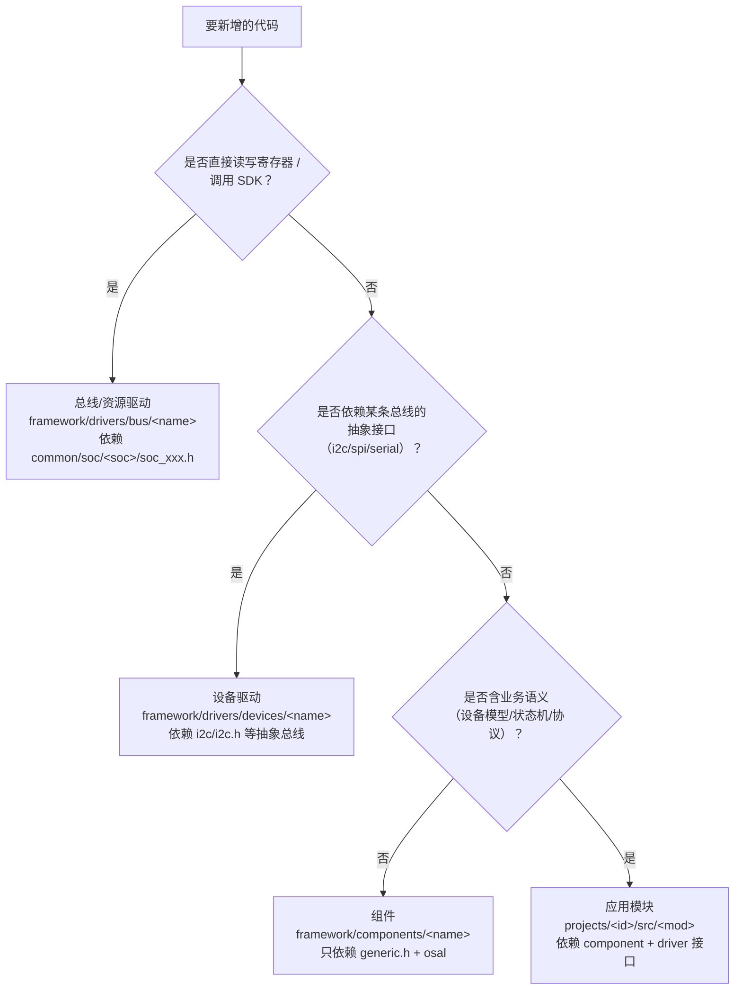

# 模块开发流程（Module Development Guide）

> 版本：v1.0（2026-10-29）
> 定位：**平台级流程手册**——规定"新增一个模块要走哪几步、每步的约束是什么、怎么验收"。
> 来源：整理自内部机器人主控工程（下称"参考实现"）的实际做法；完整对照分析见 `docs/reference/4x-mcu-framework-analysis.md`。
> 配套资产：`docs/templates/project_demo/`（工程骨架：只含产品差异）、`docs/templates/framework_demo/`（框架骨架：含示例驱动与平台后端）、`docs/guides/module-design.md`（契约与差异）、`.github/skills/add-module/SKILL.md`（流程化执行）。

---

## 目录

- [0. 结论](#0-结论)
- [1. 模块类型判定](#1-模块类型判定)
- [2. 开发流程（9 步）](#2-开发流程9-步)
- [3. 五个设计要素](#3-五个设计要素)
- [4. 五个质量目标如何达成](#4-五个质量目标如何达成)
- [5. 自检与完成标准](#5-自检与完成标准)
- [6. 模板索引](#6-模板索引)
- [7. 可借鉴的地方](#7-可借鉴的地方)
- [8. 可优化的地方](#8-可优化的地方)

---

## 0. 结论

模块开发是**固定形态的四文件 + 三处配置 + 一条 CLI**，通用性不靠"写得好"，靠**四道边界**：

| 目标 | 靠什么机制实现 |
|---|---|
| **一般性**（同一模块服务多种场景） | 描述符结构体 + 逻辑 ID + `chip` 枚举分发 + `chipParameter` 逃生口 + `#ifndef` 编译期裁剪 |
| **通用性**（多实例、多型号） | `CONFIG_*_MAX_NUM` 决定静态实例数；ID 即句柄；驱动内部"按 ID 查实例" |
| **可移植性** | 驱动只依赖**抽象总线接口**或 `soc_xxx.h` 纯接口；芯片头只出现在 `framework/port/` |
| **实例化** | **两级对象模型**：板级 `const` 描述符（ROM）+ 驱动侧静态实例数组（RAM），初始化按 ID 绑定 |
| **对象化** | 控制器单例 + 不透明类型 + 工厂函数 + 函数指针表 + `checkInstance` 句柄校验 |

一句话：**"配置是数据，实例是静态数组，ID 是句柄，芯片差异是最后一层 `switch` 和一目录 `framework/port/`。"**

---

## 1. 模块类型判定

新增代码前**必须先判定类型**，类型决定目录位置与允许依赖。



| 类型 | 例子 | 允许 include | 禁止 include |
|---|---|---|---|
| **总线/资源驱动** | gpio、uart、i2c、adc、pwm、can | `generic.h`、`common/soc/soc_xxx.h` | 业务头、`FreeRTOS.h`（除非 osal 层） |
| **设备驱动** | 传感器、EEPROM、电机驱动器 | `generic.h`、抽象总线头（`i2c/i2c.h`） | `soc_*.h`、芯片厂商头 |
| **组件** | 消息队列、流式任务、日志缓存、FIFO | `generic.h`、osal | 任何 `driver/*` |
| **应用模块** | 设备管理、运动控制、协议属性 | component + driver 的**公开头** | `soc_*.h`、`framework/port/**` |

> 判据只有一句：**"你的 `#include` 列表里有没有芯片名？"** 有 → 一定放错层了。

---

## 2. 开发流程（9 步）


### 步骤详解

| 步 | 动作 | 约束 | 产物位置 |
|---|---|---|---|
| ① 判定类型 | 按 §1 决策树 | 不确定时就近原则：**先当设备驱动，不要先当组件** | — |
| ② 逻辑 ID | 在 `src/config/export_ids.h` 增加枚举项 + `EXPORT_XXX_MAX_NUM` 哨兵 | 平台无关、产品相关；ID **从 0 连续编号**，末尾必须有 `MAX_NUM` | `projects/<id>/src/config/export_ids.h` |
| ③ 公开头 `xxx.h` | ①`#include <common/generic.h>` ②`#ifndef CONFIG_XXX_MAX_NUM` 默认值 ③`enum XXX_CHIP` ④`xxxConfig_t` 描述符 ⑤对外 API | **默认值一律 `#ifndef` 包裹**（项目可覆盖）；**API 第一参数必须是 `uint8_t id`**，不暴露实例指针 | `framework/drivers/.../xxx.h` |
| ④ 实现 `xxx.c` | ①控制器单例 ②实例数组 `[CONFIG_XXX_MAX_NUM]` ③`id → 实例` 查找 ④`switch (config->chip)` 分发 | 不得出现任何芯片头；不得 `malloc`；日志走模块级 trace | 同目录 `xxx.c` |
| ⑤ 适配 | 总线驱动 → 写 `framework/port/<soc>/soc_xxx.c`；设备驱动 → **复用**已有总线 API | **芯片差异只允许出现在这一步**；新增 `soc_` 接口要同步更新所有 `framework/port/<soc>/` | `framework/port/<soc>/` 或 `framework/drivers/bus/` |
| ⑥ 板级实例化 | 工程 `src/system/board.c` 里 `static const xxxConfig_t s_xxxs[] = {...}`；`src/config/framework_config.h` 里 `#define CONFIG_XXX_MAX_NUM EXPORT_XXX_MAX_NUM` | 引脚/地址/速率**只能出现在这里**；用**编译期 typedef 断言**校验条数（`#if` 不支持 `sizeof`） | `projects/<id>/src/system/board.c`、`projects/<id>/src/config/framework_config.h` |
| ⑦ CLI | `<name>/cli_<name>.c`：`list / read / write / dump` 四个子命令起步 | 命令必须能**独立验证硬件**，不依赖上层业务；注册进 console 初始化 | 框架 `framework/drivers/.../cli_<name>.c` |
| ⑧ 应用接入 | 需上报 → SACP 属性表；需周期动作 → 流式任务；需跨上下文 → 消息封装 | 属性表与驱动解耦：**表在应用层，驱动不认识 SACP** | `projects/<id>/src/sacp/` |
| ⑨ 构建发布 | 加入构建清单（CMake `target_sources` 或 Keil 工程勾选）→ 版本号脚本 → 变更记录 | **最容易漏**：新增 `.c` 忘加清单 → 链接期才报错 | `CMakeLists.txt` / `*.uvprojx`、`CHANGELOG.md` |

---

## 3. 五个设计要素

### 3.1 描述符（Descriptor）：配置即数据

```c
typedef struct {
    uint8_t     id;            /* 逻辑 ID */
    uint8_t     chip;          /* 芯片/载体类型，决定分发分支 */
    uint8_t     bus;           /* 抽象总线 ID（资源定位） */
    uint16_t    address;       /* 器件地址 */
    uint16_t    flags;         /* 行为位标志 */
    const char *chipParameter; /* 型号私有参数，NULL = 默认 */
} xxxConfig_t;
```

**原则**：**"变化的部分必须落进字段，不能落进代码。"** 一旦某个差异写成了 `#ifdef`，一般性就退化为分支森林。

### 3.2 两级对象模型：描述符 vs 实例

| | 描述符（Descriptor） | 实例（Instance） |
|---|---|---|
| 本质 | 配置数据，`static const` | 运行时状态，`static` 数组 |
| 存储 | Flash / ROM | RAM |
| 谁声明 | 板级配置（产品侧） | 驱动内部（模块侧） |
| 内容 | `id` / `chip` / `bus` / `address` / `flags` | `const config*` + 运行期字段（值、模式、计时） |
| 生命周期 | 全程只读 | 初始化时绑定，运行期可变 |

绑定：`xxxInit(configs, num)` → 遍历描述符 → 占用实例槽位 → `instance->config = &configs[i]`。

### 3.3 ID 即句柄

```c
gpioSet(LED_SYS, 1);
serialSend(SERIAL_CORE, buf, len);
tmplSensorRead(SENSOR_PRESSURE, &data);
```

- 优点：接口稳定、跨层不传内部指针、多实例零成本（加容量宏 + 一条描述符即可）
- 代价：需要运行期校验 `id` 合法性（`instanceFromId()` 返回 `NULL`）
- 规则：**越界必须返回错误码**，禁止解引用 `NULL`

### 3.4 容量宏 + 编译期裁剪

```c
#ifndef CONFIG_XXX_MAX_NUM
#define CONFIG_XXX_MAX_NUM   2      /* 默认值，产品可覆盖 */
#endif
/* 可选功能同理 */
#ifdef CONFIG_XXX_FEATURE_BREATH
    ...
#endif
```

- 用不到的功能编译期消失 → 省 Flash/RAM
- 哨兵 `EXPORT_XXX_MAX_NUM` 让"加了一个资源忘改容量"变成**编译错误**而非运行期越界

### 3.5 自检 CLI

`list`（枚举实例与配置）/ `read`（读当前值）/ `write`（写）/ `dump`（打印内部状态）。

理由：**上板一条命令能验证，是模块"完成"的最低门槛**，也是没有仿真器时的唯一手段。

---

## 4. 五个质量目标如何达成

| 目标 | 机制 | 反例（一出现就退步） |
|---|---|---|
| **一般性** | 描述符字段 + `chip` 枚举 + `flags` 位组合 + `chipParameter` | 为每个型号写一份 `xxx_a.c` / `xxx_b.c` |
| **通用性** | 容量宏 + 实例数组 + 逻辑 ID 查找 | 函数内 `static` 保存唯一状态（隐式单例） |
| **可移植性** | 依赖抽象接口；芯片实现集中在 `framework/port/<soc>/`；`generic.h` 统一编译器差异 | `#include "stm32xxxx_hal.h"`；`#ifdef SOC_A / SOC_B` 撒进驱动 |
| **实例化** | 两级对象模型 + 初始化绑定 + ID 查找 | 全局变量 + 直接在驱动里写死引脚 |
| **对象化** | 控制器单例、不透明类型（`typedef struct X x_t;`）、工厂函数、函数指针表、句柄校验 | 头文件暴露内部结构体，调用方直接改字段 |

**对象化的四个手段与适用场景**

| 手段 | 适用 | 说明 |
|---|---|---|
| 控制器单例 + 实例数组 | 驱动 | "一个管理器管 N 个对象"，零动态分配 |
| 不透明类型 + 工厂 | 组件 | 真封装；调用方看不到内部字段 |
| 函数指针表（`xxxOps_t`） | 芯片类型 ≥3 时 | MCU 上有间接调用成本，**<3 种用 `switch` 更划算** |
| 声明式属性表 | 协议接入 | 一个模块一张表，文档/测试由表驱动 |

---

## 5. 自检与完成标准

### 5.1 自检 5 问（写完模块前逐条确认）

1. 我的 `.c` 里出现过芯片名 / `HAL_` / 寄存器名吗？→ 出现即违规
2. 引脚 / 地址 / 波特率是否**只**出现在板级配置？→ 否则违规
3. 所有对外 API 的第一参数是 `uint8_t id` 吗？→ 否则无法多实例
4. 容量常量是 `#ifndef` 默认值 + 产品覆盖吗？→ 否则不通用
5. 有一条 CLI 或协议属性能在板上验证吗？→ 否则不算完成

### 5.2 完成标准（可执行）

```bash
# 1) 编译零警告
cmake --build --preset <board>          # 或 Keil 编译目标
# 2) host 单测通过
ctest --preset host
# 3) 分层守护：驱动/业务层不得出现芯片头
python tools/check_layers.py
# 4) 编码风格
clang-format --dry-run --Werror framework projects
# 5) 配置一致性：描述符条数 ≤ 容量宏 ≤ 导出枚举
python tools/check_config.py
```

任一条不过 = 未完成，**不允许"先合并后补"**。

---

## 6. 样板索引

代码样板**只有一份**（可编译的那份），文档只写代码表达不了的内容：

| 文件 | 对应步骤 | 位置 |
|---|---|---|
| `tmpl_sensor.h` | ③ | `docs/templates/framework_demo/drivers/devices/tmpl_sensor/` |
| `tmpl_sensor.c` | ④ | 同上 |
| `cli_tmpl_sensor.c` | ⑦ | 同上 |
| `soc_tmpl_sensor_stub.c` | ⑤ | `docs/templates/framework_demo/port/host/` |
| `export_ids.h` / `framework_config.h` | ②⑥ | `docs/templates/project_demo/src/config/` |
| `board.c` | ⑥ | `docs/templates/project_demo/src/system/` |
| `local_*.h` / `sacp_tmpl_sensor.{c,h}` | ⑧ | `docs/templates/project_demo/src/sacp/` |
| `test_tmpl_sensor.c` | ⑨ | `docs/templates/project_demo/test/` |
| 依赖假设 / 错误码 / 5 处同步清单 / 构建片段 / 常见错误 | — | `docs/guides/module-design.md` |

**落位示例**：驱动与平台后端在**共享框架**（`framework/`，一份）；
工程 `projects/<id>/` 只放产品差异。

| 位置 | 内容 |
|---|---|
| 框架 `framework/drivers/devices/tmpl_sensor/` | `tmpl_sensor.h` / `tmpl_sensor.c` / `cli_tmpl_sensor.c` |
| 框架 `framework/port/<soc>/soc_tmpl_sensor_stub.c` | 唯一允许芯片头的落点 |
| 工程 `src/config/export_ids.h` | 逻辑 ID + `EXPORT_*_MAX_NUM` 哨兵 |
| 工程 `src/config/framework_config.h` | 容量宏由枚举派生 |
| 工程 `src/system/board.c` | 描述符表（引脚/地址唯一来源）+ 编译期容量校验 + `Init` 调用 |
| 工程 `src/sacp/local_{config,attributes,groups,common}.h` + `sacp_<name>.{h,c}` | 协议开关、属性号段、上报组基址、属性表 |
| 工程 `test/test_tmpl_sensor.c` | host 单测 + 假总线 |

> 与 §2 表格的差异：步骤 ⑥ 的板级描述符表在本示例中落在 `src/system/board.c`（编译单元内 `static const`），
> 而不是板级头文件 —— 头文件里定义对象会引入重复符号。方案见 `docs/templates/project_demo/docs/design/demo-tmpl-sensor.md`。

---

## 7. 可借鉴的地方

> 以下来自"参考实现"（机器人主控工程）的实战设计，已被验证能在长期迭代中存活，建议直接采用。

| # | 可借鉴点 | 为什么值得抄 |
|---|---|---|
| 1 | **逻辑 ID 用枚举 + 哨兵 `MAX_NUM`** | 拼错即编译失败；容量自动跟随，消灭"加资源忘改容量"这类静默 bug |
| 2 | **两级对象模型（`const` 描述符 + 静态实例数组）** | 零动态内存、零 malloc，同时支持多实例；重启后状态确定 |
| 3 | **板级配置是引脚的唯一来源** | 换板只改一处；驱动里永远看不到 `GPIOx` |
| 4 | **`#ifndef CONFIG_*` 默认值 + 产品覆盖** | 模块自带合理默认，产品只写差异；配置分层清晰 |
| 5 | **`flags` 位标志 + `chipParameter`** | 用位组合表达行为差异，避免结构体派生爆炸；特殊参数不污染通用字段 |
| 6 | **每驱动自带 CLI** | 上板一条命令验证硬件；没有仿真器也能调试；比"先写单测"门槛低 |
| 7 | **协议属性表化（表驱动）** | 协议即数据，可自动导出文档；新增属性不碰协议栈 |
| 8 | **模块级 trace（`TRACE_TAG` / `TRACE_LEVEL`）** | 日志可按模块开关、编译期裁剪；现场排障定位到模块 |
| 9 | **`generic.h` 统一编译器差异**（`__INLINE` / `__PACKED` / `__WEAK`） | 同一份代码可跨 ARMCC / IAR / GCC 编译 |
| 10 | **文档按"一个机制一篇"拆分** | 可独立检索；避免单一巨型设计文档腐烂 |

---

## 8. 可优化的地方

> 同样是"参考实现"暴露的问题，我们**不照抄**，按下列改法落地。

| # | 问题 | 现状表现 | 后果 | 优化做法 |
|---|---|---|---|---|
| 1 | **`chip` 分发用 `switch`，每个 API 各写一遍** | 新增一种载体要改 N 个 switch | 漏改一处 → 某 API 静默失效 | 芯片类型 ≥3 时抽 `const xxxOps_t *ops`，API 统一 `ops->read(...)`；<3 时保留 `switch` 并加 `-Wswitch-enum` |
| 2 | **配置分散在多处，靠人同步** | 逻辑 ID / 板级表 / 容量宏 / 构建清单**四处**独立 | 漏一处编译"成功"但行为错 | `project.yaml`（或 `board.yaml`）为单一事实来源 + `tools/gen_board_config.py` 生成；配 `check_config.py` 断言 |
| 3 | **源文件集合靠手工勾选** | Keil 工程逐 target 勾选 `.c` | 新增文件漏勾 → 链接失败或功能缺失 | CMake 按目录 `target_sources` + glob 守护；Keil 侧由生成器同步 |
| 4 | **`chipParameter` 是字符串，弱类型** | `"6,7,-1,-1"`、`"remap:1"` 运行期解析 | 拼错静默失效，无编译期保护 | 改成强类型子结构体（联合体 + 枚举）；确实需要字符串时加解析失败 `elog` + 返回错误码 |
| 5 | **无 host 单测，只有上板 CLI** | 重构无回归保护；AI 无法自闭环 | 每次改动靠人肉回归 | 抽出"纯逻辑部分"编译到 x86 + Unity；HAL 适配层用**一致性测试**替代覆盖率 |
| 6 | **无静态检查门禁** | 仅有一份文字编码规范 | 规范不可执行 ≈ 不存在 | `.clang-format` + `.clang-tidy` + `-Werror -Wconversion`；规范文档只作解释 |
| 7 | **无架构守护脚本** | 分层靠约定俗成 | 半年后必然出现业务层 include 芯片头 | `tools/check_layers.py`（正则扫 include），进 pre-commit + CI |
| 8 | **`id` 越界只在运行期检查** | `instanceFromId()` 返回 `NULL` | 空指针风险 | 关键路径加 `assert(id < MAX)`；对外 API 统一 `if (id >= MAX) return RET_INVALID_ARGS;` |
| 9 | **模块注册靠 `main.c` 逐条调用** | 新增模块要改 `main.c` | 容易漏、合并冲突集中 | 模块数 >20 时用 linker section 自动注册；否则维持显式调用（更直观，别过度设计） |
| 10 | **无版本化接口** | 驱动接口变更靠全仓同步修改 | 多工程并行时互相拖累 | 接口结构体加 `abi_version`（学 CMSIS-Driver 的 `GetVersion`） |

---

## 相关文档

- `docs/templates/project_demo/` —— 工程骨架（只含产品差异）；模块样板在 `docs/templates/framework_demo/drivers/devices/tmpl_sensor/`；契约与差异见 `docs/guides/module-design.md`
- `docs/templates/framework_demo/` —— 框架层骨架（common/osal/drivers/components 最小实现，由 `docs/templates/CMakeLists.txt` 冒烟编译）
- `.github/skills/add-module/` —— 加模块的可执行流程
- `docs/reference/4x-mcu-framework-analysis.md` —— 参考实现的整体架构与对照分析
- `docs/design/platform-plan.md` —— 环境层设计（分层、约束体系、依赖策略）
