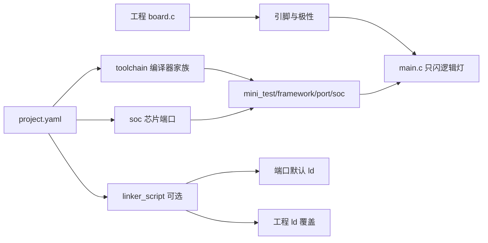

# 设计：mini_test 按芯片切换

> 测试工程 `mini_test` 用 `project.yaml` 选择芯片与工具链。平台代码暂时放在
> `mini_test/framework`，不进入仓库根 `framework/`。链接脚本由端口提供一份默认，
> 工程只在内存布局不同时另写一份。
>
> 2026-11-07 按该方案实施。

## 1. 目标与非目标

- 目标：工程只保留产品差异（选哪颗芯片、本板灯脚、可选的链接脚本覆盖）。启动文件、寄存器访问和 CPU 参数进 `mini_test/framework/port/<soc>/`。
- 目标：同一套 `main.c` 在更换 `soc` 时不改业务代码。
- 非目标：本次不实现 GD、ESP 端口，不把代码迁入仓库根 `framework/`，不做 `board.yaml` 生成器，不引入函数指针表。

## 2. 数据流与状态

构建期数据流，无运行期配置状态。灯的亮灭是 `main` 循环里的电平翻转，不单独建模状态机。

- 输入：`project.yaml` 的 `soc`、`toolchain`、`linker_script`，以及工程 `board.c` 的引脚表。
- 输出：该芯片的 elf / bin。链接脚本要么是端口默认，要么是工程覆盖，二者取其一。
- `linker_script` 为空：用 `mini_test/framework/port/<soc>/` 内的默认脚本。
- `linker_script` 为相对工程目录的路径：整份替换默认脚本。不靠“目录里有没有 ld 文件”隐式选择。

## 3. 并发与资源边界

- 执行上下文：复位后的主上下文。闪灯循环不进入 ISR。
- 可重入性：`main` 只启动一次，不可重入。
- GPIO 与毫秒延时由端口实现。延时必须有确定的时间基准，不再按 HSI 16 MHz 空转计数。
- 资源所有权：端口占用该芯片的 GPIO 与时钟使能；工程只拥有“哪只灯”这张表。
- 容量：一块板一盏逻辑灯。链接脚本的 Flash/RAM 容量以所选 ld 为准。

## 4. 设计决策

三层不要合成一个开关。

- **工具链家族**：在 `project()` 之前决定编译器。STM32 与 GD32 共用 `arm-none-eabi-gcc`。ESP 使用另一套编译器，通常由 ESP-IDF 负责启动和链接，不能只换一份 `.ld`。
- **soc**：决定 CPU 参数、启动文件、默认链接脚本、时钟和 GPIO 实现。目录为 `mini_test/framework/port/<soc>/`，按芯片一份（`stm32f446`、`gd32f303`、`esp32s3`）。不按系列做一层，再在里面写 `#ifdef`。
- **板**：决定灯脚、有效电平和晶振，写在工程 `board.c`。同一颗 STM32F446 从 PA5 换到 PC13，只改这张表，不改 `soc`。

链接脚本：

- 端口放一份该芯片的通用脚本，描述常见 Flash/RAM 起点和段布局。现有 `mini_test/project/STM32F446XX_FLASH.ld` 移入 `port/stm32f446/` 作为默认，工程中不保留副本。
- 产品布局不同时（引导程序占用 Flash 前部、外扩 RAM、容量与默认不一致），在 `mini_test/project/ld/` 另写一份，并由 `linker_script` 指向它。
- 覆盖脚本必须保留启动文件使用的符号：`_estack`、`_sidata`、`_sdata`、`_edata`、`_sbss`、`_ebss`。允许改容量、保留区和段的放置。改掉符号名则启动文件链接失败。
- 启动文件只在端口保留一份，工程不另写。F446RC 256KB 与 F446RE 512KB 用工程覆盖脚本表达，不为此复制端口。

框架位置：

- 测试期使用 `mini_test/framework`。`project.yaml` 的 `framework.path` 指向它。
- 这是相对“工程内不得复制 framework”的临时例外。不修改仓库根 `framework/`，也不引用根上的 `osal.h`。试验用的毫秒延时声明放在 `mini_test/framework` 内。
- 试验结束后再把端口上收到仓库根 `framework/port/`，并删除 `mini_test/framework`。

被否决的做法：

- 把启动文件和寄存器访问留在 `main.c`，只在 CMake 里换宏。换芯片时业务文件必然改动。
- 每个工程复制一份完整端口。GD 与 ESP 会各自分叉。
- 本次就把端口写入仓库根 `framework/`。测试工程的接口尚未稳定，会污染所有工程共用的那一份。
- 用目录中是否存在 ld 文件来决定覆盖。缺文件时静默退回默认，不容易发现配错。

厂商头（`stm32*.h`、`gd32*.h`、`esp_*.h`、`freertos.h`）只允许出现在 `mini_test/framework/port/<soc>/`。`tools/check_layers.py` 只扫描 `projects/*/src`，扫不到本目录，这条约束靠评审守住。

换芯片时另外需要考虑：

- GD32 可与 STM32 共用工具链，但时钟树、Flash 等待周期和部分寄存器不同，必须单独一份端口，不能靠换 ld 冒充。
- ESP 要换工具链文件，且必须在 `project()` 之前生效。裸机 `objcopy` 出 bin 不一定适用。FreeRTOS 与 `esp_*.h` 留在该端口内，WiFi 协议栈不进闪灯工程。
- 验收：再增加一颗芯片时，工程侧除 `soc`、`toolchain`、可选 `linker_script` 和本板引脚表外，没有文件改动。业务代码里不出现芯片 `#ifdef`。

`project.yaml` 不存放引脚、源文件清单和版本号。`id` 从模板值 `project_demo` 改为 `mini_test`。

## 5. 实施章节

### 5.1 工程身份与选择项

改 `mini_test/project/project.yaml`：`id` 为 `mini_test`，`framework.path` 为 `mini_test/framework`，保留 `soc` 与 `toolchain`，增加可空的 `linker_script`。

### 5.2 STM32F446 端口

在 `mini_test/framework/port/stm32f446/` 放入启动文件、默认链接脚本、GPIO 与毫秒延时实现、`port.cmake`。`port.cmake` 输出 CPU 参数、启动文件、默认链接脚本和端口源文件。公开头不出现寄存器地址。

### 5.3 工程应用

`main.c` 只调用 `board_init()`、按逻辑灯名翻转，并用端口提供的毫秒延时。引脚表放在工程 `board.c`。删除 `main.c` 中的 RCC / GPIO 地址和按 16 MHz 标定的空转。

### 5.4 构建选择

`CMakeLists.txt` 在 `project()` 之前使用 yaml 的工具链，之后包含该 soc 的 `port.cmake`。`linker_script` 为空时用端口默认 ld，否则用工程内那一份。工程不再写死 `-mcpu=cortex-m4` 和 `startup.s`。

## 6. 验证

- 已在主机交叉编译：`cmake -S mini_test/project -B mini_test/project/build -DARM_TOOLCHAIN_ROOT=/usr && cmake --build mini_test/project/build`。目标名为 `mini_test`，启动文件与默认链接脚本来自 `mini_test/framework/port/stm32f446/`。产物 `mini_test.elf` / `mini_test.bin`，Flash 占用 984 B。
- 已把 `linker_script` 临时设为 `ld/board.ld`，链接命令改用工程内脚本；随后恢复为 `null`。工程目录不保留这份覆盖脚本。
- `main.c` 与 `board.c` 不包含芯片厂商头，也不写寄存器地址。
- 未构建 GD、ESP。未烧录目标板。
- `clang-format` 在本环境不存在，格式检查跳过。
- `env/toolchains/` 尚未建立。`toolchain: null` 时仍使用 `ARM_TOOLCHAIN_ROOT` 下的 `arm-none-eabi-gcc`。
- `python3 tools/check_layers.py --verbose` 通过。该脚本不把 `mini_test/` 当作 `projects/*/src`，端口内的寄存器访问不在它的业务层规则里。
